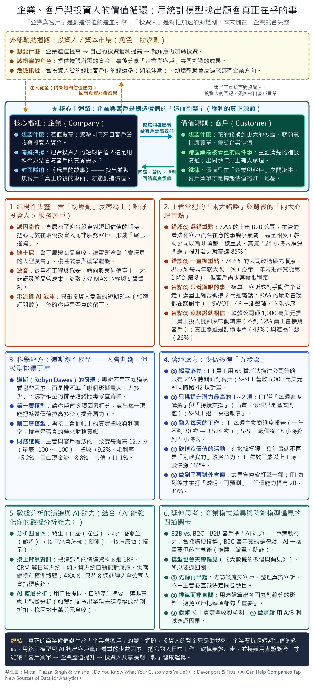
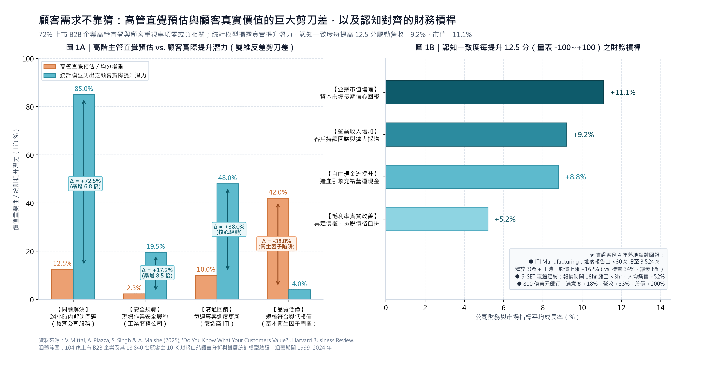

# 顧客需求不靠猜：用統計模型找回企業真金白銀的成長引擎
> **文件屬性**：高階決策備忘錄（Executive Strategy Memo） ｜ Format B 結構化綜合報告  
> **研究依據**：Vikas Mittal 等教授 7 年跨國實證研究（104 家上市 B2B 企業、18,840 位顧客、4,540 家企業 21 年 10-K 財報）  
> **發布日期**：2026 年 11 月  

---

## 壹、執行摘要：為什麼高管每週開會 12 小時，卻在 72% 的時候猜錯客戶要什麼？

在激烈的市場競爭中，幾乎所有企業領導人都堅信自己「非常了解客戶」。數據顯示，高達 93% 的企業高階主管，每週平均花費 4 到 12 個小時親自翻閱客訴紀錄、分析競爭對手動態，並召開跨部門策略會議。然而，一項長達 7 年、深入調查 104 家上市 B2B 公司與近兩萬名真實客戶的權威研究，卻揭露了一個令人震驚的殘酷真相：**在 72% 的企業中，高管認定「客戶最在乎的事」，與客戶真實重視的需求幾乎毫無關係，甚至完全相反！**

問題從來不是出在主管「不夠認真」或「缺乏數據」，而是人類大腦天生存在嚴重的判斷偏誤。主管容易被眼前的顯眼事件（如昨天的某通嚴重客訴、對手新推出的酷炫功能）牽著走，或是憑直覺臆測未經驗證的因果關係。更嚴重的是，有高達 85.5% 的企業每兩年就徹底推翻一次策略優先順序，導致第一線員工疲於奔命，企業資源像胡亂撒胡椒粉一樣被稀釋殆盡。

### ● 高管常犯的兩大直覺病灶
1. **選錯重點（抓小放大）**：誤把及格標準當作核心優勢。例如主管整天煩惱品質與降價，卻不知道客戶真正在乎的是「出問題時能不能 24 小時內幫我搞定」。
2. **頻繁換方向（策略陀螺）**：缺乏客觀數據支撐，會議上誰聲音大就聽誰的。必帝公司曾在一波流行下，一年內把「品質」從第 1 名降到第 8 名，客戶無所適從。

### ● 科學破局的巨大財務回饋（認知對齊的真金白銀）
- **營收成長 +9.2%**：當主管與客戶對「價值」的認知一致度每提高 12.5 分（量表 -100～+100），客戶回購與採購意願顯著放大。
- **毛利改善 +5.2% & 現金流 +8.8%**：不必再陷入價格血拼，具備強大定價自主權，把無效支出轉化為實質營運現金流。
- **市值提升 +11.1%**：資本市場給予清晰聚焦企業極高的長期估值溢價。

---

## 貳、生態解剖：企業、客戶與投資人的三方循環——別把「助燃劑」當成「造血引擎」

要從根本解決策略失焦的問題，企業領導者必須先看清商業體系的能量流動本質。在商業世界中，存在「企業」、「客戶」與「投資人」三個關鍵角色，但他們的地位絕對不是對等的。

- **「企業 ↔ 客戶」是唯一的價值造血引擎**：真正的商業價值，只有在客戶掏出真金白銀購買企業產品與服務的那一瞬間才會誕生。客戶之所以願意持續買單，是因為企業切中了他最在乎的痛點，給予他超越付費金額的實質效益；企業由此獲取營收與毛利，這才是公司長期存活與繁榮的唯一生命泉源。
- **「投資人」只是外部的輔助助燃劑**：資本市場提供的資金，本質是為了幫助造血引擎加快擴張腳步（例如興建新廠房、招募頂尖研發團隊），事後再合理分享「企業與客戶」共同創造的經營成果。
- **助燃劑反客為主的結構性失靈**：當外部熱錢過度湧入時，高管極易陷入「討好投資人、輕忽真客戶」的致命陷阱。例如波音公司為迎合華爾街短期估值與股息，過度樽節工程研發與品管成本，終致 737 MAX 嚴重飛安危機；迪士尼部分影視為賣周邊玩具而硬塞角色，犧牲故事品質。一旦造血引擎熄火，崩盤只是時間問題。

---

## 參、科學破局：道斯線性模型與「提升潛力」的白話本質

很多領導人會問：「我們天天在看數據，為什麼還是排不準優先順序？」心理學大師羅賓．道斯（Robyn Dawes）早在 1979 年的一篇經典研究中就給出了解答：**人類專家擅長挑選相關變數（知道哪些事情有影響），但人類大腦天生極不擅長替變數排出精準的權重（分不清哪件事的影響力是大 5 倍還是大 10 倍）。**

這就像一位廚師知道一道名菜需要鹽、糖、醬油與香菜，但他若全憑心情隨意抓比例，味道一定每次都走樣。在企業策略中，品質、價格、售後服務、業務拜訪、AI 科技等都是大家熟知的變數，但主管憑直覺開會時，往往把每一樣都當成「絕對重要」，結果全員精力分散，什麼都做不好。

### 雙層統計模型本質
1. **第一層模型（顧客價值層）**：利用客觀統計迴歸，計算出改善單一項目對整體顧客價值的「提升潛力（Lift Potential）」。
2. **第二層模型（會計連結層）**：將顧客價值評估直接串接公司內部的真實會計總帳，檢驗高評價是否真的帶來營收、毛利率與客戶留存的同步增長。

### 反直覺實證案例拆解
1. **教育服務機構**：主管直覺以為 8 個項目重要度均等（各 12.5%），但數據顯示「24 小時內解決顧客問題」一項的提升潛力獨佔 **85.0%**，現場培訓僅 11%，其餘皆趨近於零！
2. **工業維修公司**：主管直覺認為現場遵守安全作業頂多提升顧客價值 2.3%，但客戶實際提升潛力高達 **19.5%（差距 8.5 倍！）**。
3. **ITI 製造商**：主管以為低價與品質是制勝關鍵，但模型揭露這兩項只是及格門檻（提升潛力不到 4%），真正驅動高達 48% 提升潛力的是「每週主動更新進度」與「持續支援」。

---

## 肆、落地實戰：少做多得的「五步驟」操作手冊與真實企業案例

哈佛商業評論研究團隊提煉出經過嚴謹驗證的「少做多得（Do Less, Get More）」五步驟落地法：

1. **第一步：用數據揭露認知落差（正視「全員都在瞎忙」的真相）**
   - *案例*：ITI 製造商調查前 97% 員工自認清楚策略，調查後發現有 65 種版本，全員只有 24% 時間服務客戶；S-SET 流體經銷商 5,000 萬美元營收卻跑 42 項專案。
2. **第二步：用統計模型只挑選提升潛力最高的 1 到 2 個核心因素**
   - *原則*：絕不貪多，嚴格鎖定前兩項。ITI 鎖定「每週進度更新」與「持續支援」；S-SET 鎖定「快速報價」。
3. **第三步：把這 1～2 件事徹底融入每位員工的每天日常**
   - *落實*：ITI 將「每週三主動發送進度 Email」納入全員職務，年報告次數從不到 30 次暴增至 **3,524 次**；S-SET 汰除 2.2 萬個重複 SKU，引進頂級報價工具，報價時間從 18 小時縮至 **3 小時內**。
4. **第四步：依據模型數據大膽砍掉沒有價值的冗餘活動（化解辦公室政治角力）**
   - *成效*：有數據撐腰，砍計畫不再是政治鬥爭。ITI 釋放三成工時，4 年間銷售額高出同業 19.3%，利潤率提升 43%，**股價暴漲 162%（同期標普 34%、羅素 8%）**；S-SET 業務多出 35% 時間接觸客戶，人均銷售激增 52%。
5. **第五步：做到卓越水準之後，才對外大張旗鼓宣傳**
   - *紀律*：拒絕承諾跳票。S-SET 報價壓進 5 小時後才推出品牌保證並連結績效獎金；ITI 卓越後主打「透明可預測」，**定價能力提高 20%～30%**。市值 800 億美元銀行改善等候時間與線上安全，營收增 33%，**股價大漲 200%（道瓊 140%）**。

---

## 伍、延伸防禦：商業模式差異與防範演算法偏見的「四道關卡」

### 1. 商業模式差異：B2B 的硬指標 vs. B2C 的幕後絲滑體驗
- **B2B 客戶是理性組織**：採購決策直接影響其自身財務獲利，故「AI 科技實力」與「專案執行力」會直接成為合約上的硬指標。
- **B2C 客戶看重最終體驗**：消費者買的是省時、好玩、便宜。AI 一樣至關重要，但必須隱藏在推薦、派單與風控的幕後。

### 2. 防範「數學毀滅武器」的四道防線
1. **第一關（開放式探索）**：深入訪談流失客戶與真實客訴，由客戶痛點產生問卷題目，防止高管自戀式出題。
2. **第二關（間接推導重要性）**：用統計迴歸推算權重，不直接問「哪項重要」，破除客戶每項都勾重要的社會期許偏誤。
3. **第三關（對接會計帳本）**：將滿意度串連 ERP 真實利潤與回購，杜絕自嗨虛榮指標。
4. **第四關（隨機對照實驗 A/B Test）**：小規模分組實驗驗證因果關係，避免把巧合當因果。

---

## 陸、高管自測檢核清單

| 項次 | 檢視面向 | 現況危險徵兆（若符合請打勾） | 科學矯正處方 |
| :---: | :--- | :--- | :--- |
| **1** | **策略版本一致度** | 問 5 位主管公司今年第一優先，得到 3 種以上答案 | 啟動顧客雙盲調查，強制量化對齊 |
| **2** | **在線專案數量** | 公司同時運作超過 15 個跨部門重要專案 | 依提升潛力只留前 1～2 項，其餘封存 |
| **3** | **優先順序變動** | 過去 3 年核心 KPI 主軸已經大改過 2 次以上 | 認知客戶深層需求極度穩定，維持定力 |
| **4** | **一線客戶工時** | 業務與服務人員面對客戶工時低於 40% | 砍除無效內部行政，釋放 30% 工時 |
| **5** | **宣傳與執行的時序** | 服務品質尚未頂尖前，就搶先向市場做行銷承諾 | 堅持「做到卓越才宣揚」，保障定價權 |

---

> **結語**：真正的商業成長，從來不是來自把每件事都做得平庸，而是敢於砍掉 90% 不具提升潛力的瑣碎計畫，傾全公司之力，把客戶真正在乎的那一兩件事做到徹底卓越。
