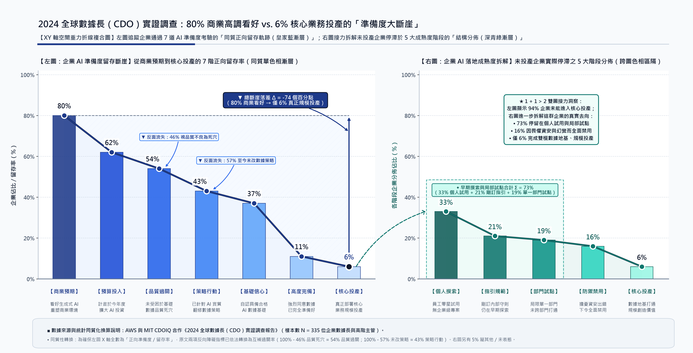

# 【高階決策白皮書】從流沙到混凝土：生成式 AI 時代的企業數據治理與資產準備度策略
## Enterprise Data Readiness & Governance Strategy for Generative AI: From Quicksand to Concrete

> **文件體裁**：B1 高階決策與策略白皮書 (1:3:25 Executive Strategy Whitepaper)  
> **制定依據**：Thomas H. Davenport & Priyanka Tiwari 實證調查研究 (MIT Sloan / AWS, $N=334$ CDO) 暨認知科學與數據工程範式  
> **適用對象**：董事會、執行長（CEO）、數據長（CDO）、資訊長（CIO）、技術長（CTO）與業務部門負責人  
> **發布日期**：2026-11-01 ｜ **版本**：v2.0 Publication Grade

---

## 壹、【決策主訊息】破除算力迷思與流沙微調：三大 So-What 戰略行動斷言

> [!IMPORTANT]
> - ● **【破除資料短缺迷思】** — 企業非結構化數據以年增 50% 以上幾何級數膨脹（佔總量 80%～90%），但 **80% 的變革預期僅轉化為 6% 的核心生產落地**；高達 **46% 數據長指認「數據品質與多源衝突」為首要死穴**。大語言模型無法自動消歧矛盾事實，將未治理的「流沙暗數據」餵給 AI，只會以極高效率自動化放大組織錯誤。
> - ● **【終結提示詞萬能論】** — 波蘭尼默會知識悖論證明「人類知道的遠比能說出來的多」，企圖在 Prompt 撰寫窮盡規則必然遭遇組合爆炸與長尾邊緣案例的「自信偽陽性」。企業必須建構**「剛性左腦（受控本體庫 Ontology、主數據管理 MDM）」$\times$「靈性右腦（LLM 高維語義抽取）」$\times$「前額葉（領域專家 HITL 仲裁 $<5\%$ 邊緣衝突）」**之三層協同體系。
> - ● **【非對稱試點破局法】** — 高達 **71% 數據長因傳統數據債未清與跨部門權力博弈而選擇觀望**，57% 至今未對數據策略做任何修改。破局之道在於**嚴禁直接拿核心財務或研發數據試錯**，優先切入「客服坐席輔助」與「軟體工程代碼生成」兩大具備即時真人覆核或編譯器確定性驗證之非對稱優勢場景，在 90 天內跑通治理飛輪。

---

## 貳、【現狀與衝突診斷】為何 80% 投資熱潮僅換來 6% 生產落地：流沙地基引發的全面停滯

### 一、 企業生成式 AI 準備度之 SCQA 戰略情境對照矩陣

全球企業高層對生成式 AI 抱持空前期待，但絕大多數組織卻困在「個人零星試用」與「部門概念驗證（POC）」的泥沼中。以下基於 Ehrenberg 科學化表格規範，收斂 MIT Sloan 針對 334 位數據長（CDO）之核心實證發現：

| 結構維度 | 核心組織現實與因果機制推演 | 關鍵實證統計 ($N=334$) | 標竿企業實踐與正反對照 |
| :--- | :--- | :--- | :--- |
| **情境 (Situation)** | 生成式 AI 突破過往僅能處理二維結構化表格的限制，開始吞吐文本、語音與影像等非結構化資產，引發董事會空前關注。 | • **80%** 預期徹底重構商業環境 • **62%** 計畫增加 AI 經費支出 • **93%** 認同數據策略至關重要 | 數據長（CDO）從幕後走向台前，成為企業轉型「舞會上的焦點」。 |
| **衝突 (Complication)** | 企業內部非結構化內容長期缺乏治理，指標定義互斥、連結失效、版本過期；大模型直接吞食髒數據引發嚴重幻覺級聯與資安恐慌。 | • **僅 6%** 正式部署至核心生產 • **46%** 視「數據品質」為最大死穴 • **57%** 至今未修改企業數據策略 • **16%** 因資安顧慮下令全面禁用 | 高達 **89%** 企業停滯於個人摸索（33%）、指引制定（21%）或局部試點（19%），無法產生經濟價值。 |
| **核心問題 (Question)** | 當非結構化數據生成速度以指數級壓倒人工整理速度時，企業如何在不損失高維語義的前提下，建立零幻覺的「單一真實來源（SSOT）」？ | • **僅 37%** 同意具備 AI 數據基礎 • **僅 11%** 強烈同意基礎已就緒 • **71%** 優先處理傳統數據方案 | 傳統 ETL 線性處理通量 vs. 非結構化暗數據指數膨脹之結構性剪刀差。 |
| **★ 策略解答 (Answer)** | **放棄「將所有文字壓平為二維表」與「純靠 Prompt 硬解」，轉向「雙腦分層認知架構」＋「非對稱 MVP 試點」雙軌推進。** | **• 25% 領先者聚焦數據整合清理 • 18% 盤點高價值支援數據集 • 17% 啟動特定領域文本策劃** | **• 摩根士丹利：5 年內容審核與評分體系 • 默克與賽諾菲：打造混凝土地基與數據經緯** |

### 二、 空間重力折線斷崖與雙圖接力下之 CDO 調查實證全景圖

*圖 1：MIT Sloan & AWS 數據長 (CDO) 調查實證 —— 統一 Y 軸高度比例尺 (0%～100%) 下之企業 AI 準備度留存斷崖與成熟度拆解（左圖以皇家藍同質漸層與折線軌跡刻劃從 80% 商業預期俯衝至 6% 核心投產之單調斷崖，並將反向阻礙換算為 54% 品質過關與 43% 策略行動；右圖以深青綠同質漸層接力拆解未投產企業停滯於 73% 早期摸索試點與 16% 全面禁用之結構分布）。*

---

## 參、【底層機制與理論壁壘】為何單靠 Prompt 無法取代數據治理：非結構化剪刀差與三大工程陷阱

### 一、 非結構化數據通量剪刀差與「技術數據債」累積模型

在第一階段深度思辨中，我們探討了一個核心問題：**「既然企業擁有海量歷史文本，為何不能直接交給大語言模型透過 Few-Shot Prompt 自動結構化，省去耗時數年的數據清理？」**

1. **直覺問題意識（Intuitive Premise）**：傳統結構化資料僅佔企業數據冰山一角（10%～20%），而會議紀錄、客訴工單、合約與研究報告等非結構化數據佔比高達 80%～90%。當人工審核與固定關聯式 Schema 的處理速度遠落後於文本生成速度時，未治理的暗數據將形成吞噬算力價值的黑洞。
2. **通量剪刀差與數據債積分模型（Throughput Divergence Formula）**：
   $$\Delta_{\text{Debt}}(t) = \int_0^t \left[ \alpha \cdot e^{\lambda \tau} - \left( \beta_{\text{human}} \cdot M(\tau) + \gamma_{\text{AI}} \cdot I_{\text{MDM}}(\tau) \right) \right] d\tau$$
3. **參數物理意義與極端邊界推演（Boundary Conditions）**：
   - $\alpha \cdot e^{\lambda \tau}$：企業非結構化數據之指數生成速率（年複合增長率 $\lambda \ge 50\%$）。
   - $\beta_{\text{human}} \cdot M(\tau)$：純依賴人工專家審核與傳統 ETL 的線性處理通量，受限於組織人力上限 $M(\tau)$。
   - $\gamma_{\text{AI}} \cdot I_{\text{MDM}}(\tau)$：導入 AI 輔助抽取之有效治理通量，其係數直接受制於底層主數據架構完備度指標 $I_{\text{MDM}} \in [0, 1]$。
   - **極端邊界推演**：當企業未建立主數據治理（$I_{\text{MDM}} \to 0$）時，即便盲目擴充算力，AI 產出皆為未對齊之局部碎片，隨時間 $t \to \infty$，數據債 $\Delta_{\text{Debt}}(t) \to +\infty$（淪為流沙沼澤）；唯有確立剛性主數據標準（$I_{\text{MDM}} \to 1$），方能釋放 $\gamma_{\text{AI}}$ 的指數級自動結構化槓桿。

### 二、 企圖以 Prompt 取代數據工程之「三大深層系統性陷阱」

若缺乏底層資料治理，單純在提示詞（Prompt）中塞入大量範例與規則，必然在生產環境觸發以下三大不可逆的工程崩潰：

| 陷阱維度 | 陷阱一：波蘭尼悖論與長尾「自信偽陽性」 | 陷阱二：局部單篇抽取 vs. 全局實體消歧斷層 | 陷阱三：資訊維度壓平損耗 vs. 後設資料缺失 |
| :--- | :--- | :--- | :--- |
| **底層機制原理** | 波蘭尼指出「我們知道的遠比能說出來的多」。Few-Shot 範例僅能覆蓋 80% 常態分布（In-Distribution），無法窮盡隱含法規與歷史脈絡。 | 大模型擅長在「單篇文檔」內提取欄位，但天生缺乏跨 10 萬份歷史檔案的「全局實體唯一性校驗（Entity Resolution）」能力。 | 生成式 AI 的革命性優勢在於高維潛在向量空間（Embeddings）的語境理解；強行將所有文本壓平回二維表格屬於降維倒退。 |
| **具體失效場景** | 遇到 20% 罕見長尾合約（如特殊豁免條款）時，模型不會回答「不確定」，而是極度自信地硬套最接近的常規範本，輸出格式完美但語意相反的標籤。 | 文件 A 稱「台積電」、文件 B 稱「TSMC」、文件 C 稱「3nm 專案組」且各篇記載信用額度互斥，LLM 無法判定何者為最新權威事實。 | 將客戶投訴電話壓成「情緒：負面、類別：退貨」兩個死板欄位，徹底抹殺了語氣急迫度、潛在訴訟威脅與細微產品缺陷脈絡。 |
| **★ 工程破局對策** | **導入置信度閾值閘門（Confidence Gate），低於 90% 之長尾案例強制轉交人類專家（HITL）仲裁。** | **建立剛性「主數據管理（MDM）」與「受控本體詞庫（Ontology）」，鎖定單一真實來源（SSOT）。** | **保留非結構化原文向量，改為治理「後設資料層（Metadata：時效戳記、作者權威度、審核分數）」。** |

---

## 肆、【破局系統架構】雙腦分層認知系統與 Ehrenberg 科學對照實證

### 一、 現代企業數據準備度之「雙腦分層認知架構 (Bicameral Cognitive Architecture)」

為同時達成「100% 事實零幻覺」與「海量非結構化文本之高維語義理解」，企業必須摒棄單軌思維，建構仿生學之三層認知分流架構：

1. ● **【剛性左腦：確定性數據地基】** — 由數據工程師與領域專家主導，包含**受控本體詞庫（Ontology）**、**主數據管理（MDM / SSOT）**、**數據經緯（Data Fabric）**與**後設資料目錄（Data Catalog）**。左腦不負責生成內容，而是作為絕對的「事實憲法」，規定「什麼名詞代表什麼唯一實體、哪份文件具備最高權威分數」（如摩根士丹利耗時 5 年打造的核准審核與文件評分體系）。
2. ● **【靈性右腦：高維語義大模型】** — 由生成式 AI（LLM + RAG 檢索增強生成 + 向量資料庫）組成。右腦負責吞吐海量非結構化文本、進行跨模態語境理解、模糊匹配與候選結構化標籤抽取，但**右腦的一切抽取結果必須強制向「左腦本體庫」進行實體對齊與校驗**。
3. ● **【前額葉：人機迴路長尾仲裁】** — 設置自動化「置信度路由閘門（Confidence Router）」。當右腦抽取結果與左腦 MDM 完全吻合且置信度 $\ge 90\%$（佔比約 95%），直接自動寫入數據庫；當遭遇跨文件事實衝突或長尾罕見條款（置信度 $< 90\%$，佔比 $< 5\%$），系統自動攔截並升級至人類知識策劃人（Knowledge Curator）進行仲裁，仲裁結果同步反哺更新左腦詞庫與右腦 Few-Shot 範例庫。

### 二、 Ehrenberg (1977) 科學化架構對照表：三種數據治理模式之極限檢驗

本表嚴格遵循 Ehrenberg 三線表規範（依綜合效能排序、垂直同欄比較、2 位有效數字、決策底線收斂）：

| 評估維度與核心指標 | 模式 A：純人工專家整理 *(傳統精英工匠模式)* | 模式 B：純 Prompt / Few-Shot *(輕信技術直覺模式)* | 模式 C：雙腦分層人機協同 *(現代數據工程最佳實踐)* |
| :--- | :---: | :---: | :---: |
| **單位文檔治理成本** | \$45 / 篇 (極高昂) | \$0.02 / 篇 (極低廉) | **\$1.2 / 篇 (最適成本效益)** |
| **單日處理通量上限** | 20 篇 / 人 (線性瓶頸) | 50,000 篇 (無校驗狂奔) | **10,000 篇 (受控高通量)** |
| **長尾案例幻覺錯誤率** | $< 0.5\%$ (專家嚴格把關) | $18\%$ (高且具隱蔽偽陽性) | **$< 1.0\%$ (前額葉閘門攔截)** |
| **跨來源實體消歧準確率** | $65\%$ (受限於人腦記憶跨度) | $12\%$ (完全缺乏全局校驗) | **$95\%$ (左腦 MDM 圖譜對齊)** |
| **高維非結構化語義保留** | $40\%$ (人工摘要丟失細節) | $30\%$ (強行壓平二維表損耗) | **$88\%$ (向量嵌入 + Metadata)** |
| **組織建置與見效週期** | 3～5 年 (緩慢累積) | 1 週 (上線即埋下數據債) | **3～6 個月 (分領域漸進飛輪)** |
| **★ 核心決策收斂底線** | **僅適用於極少數頂級合規資產** | **★ 嚴禁單獨用於企業核心生產** | **★ 跨越 6% 生產鴻溝之唯一正解** |

---

## 伍、【落地路線圖與權責矩陣】破除 71% 組織觀望：非對稱 MVP 試點與 18 個月推進計畫

### 一、 破解組織僵局：為何高達 71% 數據長選擇「再等等」？

調查揭示一個驚人悖論：儘管 93% 數據長深知數據策略對生成式 AI 至關重要，卻有 **71% 數據長坦言「目前更重視從其他傳統數據方案取得實際價值」**，導致轉型步調停滯。其背後存在三大組織阻力：
- ● **【歷史結構化數據債未清】** — 數據長過往職責集中於 ERP、財務報表與傳統機器學習之結構化數字治理，面對突然湧現的非結構化文本浪潮，既有團隊缺乏知識策劃人（Knowledge Curator）編制。
- ● **【高層主導權政治角力】** — 企業內部對於生成式 AI 應由數據長（CDO）、資訊長（CIO）、技術長（CTO）或數位長主導尚無定論，多頭馬車導致數據治理責任懸空。
- ● **【非對稱試點破局處方】** — 企業切忌試圖一次性清理全公司所有非結構化數據！必須挑選**「具備天然容錯網或即時確定性驗證」**的兩大非對稱優勢領域作為首波 MVP：
  1. **第一優先：顧客經營（客服坐席輔助與知識檢索）** — 輸出結果由真人客服坐席先看過再回覆客戶（天然 Human-in-the-Loop 防護網），零外部合規風險，且能立即縮短 30% 案件查找與處置時間。
  2. **第二優先：軟體工程（程式碼生成與舊代碼重構）** — 具備編譯器（Compiler）、語法檢查器（Linter）與自動化單元測試組成的「毫秒級確定性驗證迴圈」，AI 生成品質瞬間見真章（如環球音樂亦同步於核心研發探索受版權保護之 AI 創作者工具）。

### 二、 18 個月三階段漸進式落地路線圖 (Phased Implementation Roadmap)

- **Phase 1：地基盤點與受控本體建立（Month 1 ～ Month 4）**
  - 完成高價值領域非結構化暗數據盤點（18% 先行者做法），剔除過期失效連結。
  - 建立首個業務領域之「受控本體詞庫（Ontology）」與文檔可信度評分標準（對標摩根士丹利模式）。
- **Phase 2：非對稱 MVP 試點與數據經緯部署（Month 5 ～ Month 10）**
  - 上線「客服坐席輔助」與「軟體工程代碼生成」雙 MVP 試點，配置 $<5\%$ 長尾衝突專家仲裁迴路。
  - 部署具備後設資料層（Metadata Layer）之數據經緯（Data Fabric，對標默克集團混凝土架構）。
- **Phase 3：全局主數據融合與核心業務規模化生產（Month 11 ～ Month 18）**
  - 打通跨部門實體消歧（MDM）與企業級知識圖譜（GraphRAG），將非結構化資產轉化為受治理之戰略護城河。
  - 將生成式 AI 正式推向行銷客製化、核心產品研發與高階決策分析，全面跨越 6% 生產落地鴻溝。

### 三、 跨職能 RACI 權責劃分矩陣（終結 CDO / CIO / CTO 多頭馬車內耗）

| 轉型里程碑與核心治理任務 | 數據長 (CDO) | 資訊長 / 技術長 (CIO/CTO) | 業務領域專家 (BU / Curator) | 法務與合規長 (CLO / CISO) |
| :--- | :---: | :---: | :---: | :---: |
| **1. 業務受控本體詞表 (Ontology) 與標準定義** | **A (主責拍板)** | C (系統相容諮詢) | **R (撰寫領域詞條)** | C (合規術語審查) |
| **2. 數據經緯 (Data Fabric) 與向量基建部署** | C (定義治理規格) | **A / R (架構建置)** | I (知會存取介面) | C (資安邊界審核) |
| **3. 非對稱 MVP 試點 (客服/代碼) 選型與驗證** | **A (價值統籌)** | R (API 與模型整合) | **R (業務場景實測)** | I (知會上線範圍) |
| **4. 前額葉人機迴路 (HITL) 長尾衝突仲裁機制** | R (設計評分流) | I (提供標註工具) | **A / R (日常專家仲裁)** | C (免責與版權界定) |
| **★ 5. 主數據管理 (MDM) 單一真實來源鎖定** | **★ A / R (唯一真理守門人)** | **R (管線強制對齊)** | **C (跨部門指標協商)** | **I (稽核軌跡備查)** |

---

## 陸、【終章收束與立即行動檢核】董事會三大黃金鐵律與外部全景圖譜索引

> [!TIP]
> ### 🏆 董事會與高階主管之「三大黃金決策鐵律」
> 1. **數據治理非事後補丁，而是模型成敗的唯一物理邊界**：大語言模型只是高辛烷值燃油，經過審核、具備單一真實來源（SSOT）與後設資料標籤的企業知識庫才是引擎。
> 2. **剛性左腦與靈性右腦缺一不可**：不建立外部本體詞庫與主數據管理（MDM），企圖只靠 Prompt 微調解決數據混亂，等同於在流沙上加蓋摩天大樓。
> 3. **以短反饋非對稱試點啟動組織飛輪**：切勿等待全公司數據完美才行動，亦不可直接拿高風險核心資產裸奔；從客服與代碼生成切入，邊創造現金流邊償還非結構化數據債。

### 📋 決策層「星期一立即啟動」四步檢核清單 (Monday Action Checklist)
- [x] **Step 1｜終結權力爭奪**：召開 CDO-CIO-BU 聯席會議，正式簽署上述 RACI 權責矩陣，確立 CDO 對非結構化數據品質之最終審定權（Accountable）。
- [x] **Step 2｜凍結盲目微調**：立即全面暫停將未清洗、未標註時效與權威等級之內部歷史文檔直接灌入大模型微調（Fine-tuning）之高風險專案。
- [x] **Step 3｜編纂首部本體庫**：指派資深業務專家組成「知識策劃人（Knowledge Curator）」小組，於 60 天內完成首個核心業務領域之受控詞表與文檔評分卡。
- [x] **Step 4｜立項雙軌 MVP**：啟動為期 90 天之「客服坐席知識輔助」或「研發代碼生成」試點，強制綁定置信度閾值與真人覆核迴路。

### 🗺️ 跨媒介高解析度全景知識圖譜附件索引 (External High-Res Panoramic Diagrams)
為遵循 ISO 9241 視覺工學並確保最佳閱讀字級，本白皮書配套之兩幅高密度全景結構圖以獨立高解析度圖檔（300 DPI）交付於同一目錄：
1. **[`01_article_master_structure_map.png`](./01_article_master_structure_map.png)**：《企業數據資產面對生成式 AI 的準備度與治理策略 — 瑞士網格宏觀結構全景圖》（涵蓋現狀斷崖、流沙死穴、雙腦架構與非對稱破局四大象限完整因果鏈）。
2. **[`02_bicameral_data_architecture.png`](./02_bicameral_data_architecture.png)**：《企業數據雙腦認知架構與非對稱治理推進管線專題圖》（詳解剛性左腦 MDM、前額葉 HITL 路由閘門與靈性右腦 GraphRAG 之工程拓撲）。

---

**白皮書核准與簽署欄（Executive Sign-Off）**：  
**企業 AI 與數據治理轉型委員會（CDO / CIO / CTO Joint Steering Committee）** ｜ **文件編號**：`MIT-CDO-20261101-B1`
