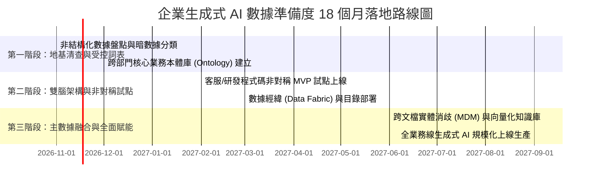

# 【高階決策白皮書】從流沙到混凝土：生成式 AI 時代的企業數據治理與資產準備度策略
## Enterprise Data Readiness & Governance Strategy for Generative AI: From Quicksand to Concrete

> **文件屬性**：B1 高階決策與策略白皮書 (Executive Strategy Whitepaper)  
> **制定依據**：Thomas H. Davenport & Priyanka Tiwari 調查研究 (MIT Sloan / AWS, $N=334$ CDO) 暨認知科學與現代數據工程範式  
> **適用對象**：董事會、執行長（CEO）、數據長（CDO）、資訊長（CIO）、技術長（CTO）與數位轉型決策層  
> **發布日期**：2026-11-01 | **版本**：v1.0 Final

---

## 壹、 決策主訊息框 (Main Messages — 3 大 So-What 核心斷言)

> [!IMPORTANT]
> 1. **【破除資料短缺迷思：缺的不是總量，而是具備單一真實來源的「混凝土地基」】**  
>    企業內部非結構化數據以幾何級數膨脹（佔總量 80%~90%），但 80% 的熱潮僅轉化為 **6% 的生產環境落地**，高達 **46% 的數據長指出「數據品質與來源衝突」是第一死穴**。大語言模型無法自動消歧矛盾事實，將未經治理的暗數據餵給 AI，只會以極高效率自動化放大組織內部的錯誤與幻覺。
> 
> 2. **【終結 Prompt 萬能論：以「雙腦分層認知架構」破解規則窮盡性詛咒】**  
>    波蘭尼悖論證明「人類知道的遠比能說出來的多」，依賴 Prompt 撰寫窮盡規則必然遭遇組合爆炸與長尾邊緣案例的自信偽陽性。企業必須建構**「左腦（本體詞庫、數據經緯 Data Fabric、主數據管理 MDM 零幻覺地基）」$\times$「右腦（LLM 高維語義抽取與模糊匹配）」$\times$「前額葉（領域專家 HITL 長尾仲裁）」**之三層協同體系。
> 
> 3. **【非對稱 MVP 破局路徑：以高容錯短反饋試點啟動組織飛輪，拒絕流沙微調】**  
>    71% 數據長因守舊慣性或權力博弈對生成式 AI 裹足不前。破局策略在於**嚴禁直接拿核心財務/臨床數據試錯**，優先切入「客服坐席輔助」與「代碼工程生成」等具備即時編譯/真人覆核機制的非對稱優勢場景，以最低試錯成本累積可遷移之治理經驗與提示範本。

---

## 貳、 執行摘要與 SCQA 現狀矩陣 (Executive Overview & SCQA Matrix)

### 一、 SCQA 戰略情境矩陣

| 結構維度 | 核心情境與組織現實 | 關鍵統計與實證依據 |
| :--- | :--- | :--- |
| **情境 (Situation)** | 生成式 AI 橫空出世，技術範式從處理二維數字表格跳躍至吞吐非結構化文本、語音與影像，引發企業董事會與高層的空前投資熱情。 | • **80%** CDO 認為生成式 AI 將徹底重構商業環境。<br>• **62%** 企業計畫實質增加相關經費支出。 |
| **複雜/衝突 (Complication)** | 絕大多數企業內部數據處於「未受治理的流沙狀態」，各部門指標互相矛盾、缺乏血緣標籤、文檔版本陳舊過期，大模型直接吞食引發嚴重幻覺級聯。 | • **僅 6%** 企業真正將生成式 AI 部署至生產環境。<br>• **46%** CDO 坦承「數據品質不良」是首要落地障礙。<br>• **57%** 企業至今未對數據架構做出任何適應性調整。 |
| **核心問題 (Question)** | 當數據生成速度以指數級壓倒傳統人工結構化速度時，企業應如何重構數據治理策略？能否透過 AI 自我結構化配合人機協同，在控制風險的前提下實現數據資產就緒？ | • 傳統 ETL 線性吞吐量 vs. 非結構化數據幾何級數增長之剪刀差。<br>• 如何在無損語義的前提下建立「單一真實來源（SSOT）」？ |
| **策略解答 (Answer)** | 放棄「將所有文字壓平為表格」的舊思維，轉向「雙腦分層架構」：以主數據管理（MDM）與受控詞表（Ontology）打造剛性左腦，結合 LLM 弱監督抽取，並以非對稱 MVP 試點打破 71% 組織觀望僵局。 | • 摩根士丹利 5 年審核體系（Knowledge Curation）。<br>• 默克（Merck）與賽諾菲（Sanofi）的「數據經緯（Data Fabric）」戰略。 |

---

## 參、 底層機制診斷與三大理論壁壘 (Deep Mechanism Diagnostics)

### 一、 非結構化數據的「指數剪刀差」與暗數據沉積定理

企業面臨的第一個殘酷現實，是結構化處理通量與數據生成通量的維度脫節：

- **直覺問題意識**：為什麼過去依賴工程師寫規則與手動維護資料表的方法，在生成式 AI 時代徹底崩潰？
- **通量剪刀差模型 (Throughput Divergence Formula)**：
  $$\Delta_{\text{Debt}}(t) = \int_0^t \left( \alpha \cdot e^{\lambda \tau} - \beta \cdot M(\tau) \right) d\tau$$
- **參數物理意義與邊界推演**：
  - $\alpha \cdot e^{\lambda \tau}$：企業內部非結構化數據（郵件、會議錄音、工單、Slack 對話、報告）之指數生成速率（年增率超過 50%）。
  - $\beta \cdot M(\tau)$：依賴人工審核、固定關聯式 Schema 與傳統 ETL 的數據處理通量，受限於組織人力 $M$，增長本質為亞線性。
  - 當 $t \to \infty$ 時，未治理的「技術數據債（Technical Data Debt）」呈發散狀態，企業數據庫淪為無人敢用的「數據沼澤（Data Swamp）」。

---

### 二、 為何不能單靠 Prompt 窮盡規則？三大深層陷阱解剖

針對「能否透過給予模型海量範例、分析方式與完善情境（Few-Shot ICL），就能一勞永逸解決結構化問題」之工程直覺，實證與計算語言學揭示了三大不可逆的系統性陷阱：

```
┌────────────────────────────────────────────────────────────────────────┐
│                        三大深層工程陷阱解剖                            │
├────────────────────────────────────────────────────────────────────────┤
│  [陷阱 1: 長尾 OOD 語義漂移]   [陷阱 2: 局部單篇 vs 全局 MDM]   [陷阱 3: 資訊壓縮損耗] │
│  常見 80% 範本覆蓋良好        單篇表格抽取精確無誤            強行壓平為固定二維表   │
│  遇到 20% 邊緣未知案例        跨文件實體衝突無法判定          抹殺語音/情緒/隱含因果 │
│  ──────────────               ──────────────                  ──────────────         │
│  ▼ 產生「自信的偽陽性」        ▼ 失去「單一真實來源 (SSOT)」   ▼ 丟失非結構化核心洞察 │
└────────────────────────────────────────────────────────────────────────┘
```

#### 1. 波蘭尼默會知識悖論與長尾邊緣案例的「自信偽陽性（Structural False Positive）」
* **機制原理解析**：波蘭尼（Michael Polanyi）指出「我們知道的遠比我們能說出來的多」。企業歷史報告背後隱含著撰寫者當時的法規背景、政治妥協與未言明的默會常識。
* **致命後果**：Few-Shot Prompt 僅能窮盡典型分佈（In-Distribution）。當模型遇到長尾極端案例（如一筆帶有特殊違約免責條款的合約）時，它不會拒絕回答，而是會**「極度自信地硬套最接近的常規範本」**，輸出看似格式完美的錯誤結構化標籤。這種隱蔽的偽陽性將直接滲透至高層決策。

#### 2. 局部單篇抽取（Local Parsing）與全局主數據消歧（Entity Resolution）的斷層
* **機制原理解析**：大模型能在單篇文檔內以 98% 的準確率提取出「客戶名稱、合約金額、付款週期」。但當系統面對 10 萬份跨國文件時：
  * 文件 A 寫「台灣積體電路」、文件 B 寫「TSMC」、文件 C 寫「TSMC 3nm 專案小組」；
  * 文件 A 標註信用額度為 1,000 萬，文件 C 卻因爭議訴訟標註信用凍結。
* **致命後果**：大模型**天生不具備全局圖譜的一致性校驗能力**。如果沒有底層主數據管理（Master Data Management, MDM）來判定誰是權威版本，多個看似結構化的局部數據將在資料庫中互相打架，導致商業分析全面失真。

#### 3. 資訊維度壓平損耗（Lossy Compression）vs. 後設資料層治理
* **機制原理解析**：生成式 AI 的核心革命在於它能直接在高維潛在向量空間（Latent Embeddings）運算，捕捉文字的情感、語調與語境。
* **致命後果**：若執著於「把所有文字硬塞回二維表格」，實則是退步回 1980 年代的關聯式思維。企業真正需要的數據準備，不是將文字轉化為文字方塊，而是建立**後設資料（Metadata：撰寫者權威等級、時效性戳記、審核狀態分數）**與數據血緣。

---

## 肆、 破局架構：雙腦分層認知系統與 Ehrenberg 科學對照表

### 一、 雙腦分層認知架構 (Bicameral Cognitive Hierarchy)

為兼顧「嚴謹零幻覺」與「海量非結構化語義理解」，現代企業數據架構必須採行三層分流：

```
                ┌─────────────────────────────────────────┐
                │   【前額葉：Human-in-the-Loop 領域專家】   │
                │   僅仲裁 <5% 左右腦衝突或低置信度長尾案例   │
                └───────────────────▲─────────────────────┘
                                    │ 衝突升級 (Escalation)
         ┌──────────────────────────┴──────────────────────────┐
         │                                                     │
┌────────┴─────────────────────────┐         ┌─────────────────┴─────────────────┐
│  【剛性左腦：確定性數據基底】    │         │  【靈性右腦：高維語義大模型】     │
│  • 受控本體詞表 (Ontology)       │  校驗   │  • 非結構化文字語境理解           │
│  • 主數據管理 (MDM / SSOT)       │ ◄─────► │  • 弱監督實體抽取 (Few-Shot)      │
│  • 數據經緯 (Data Fabric)        │  對齊   │  • 多模態非結構化關聯發掘         │
│  • 數據目錄與血緣 (Data Catalog) │         │  • 初階候選標籤生成               │
│  [特性：確定性演算法、100% 零幻覺]│         │  [特性：高泛化力、模糊匹配、強聯想]│
└──────────────────────────────────┘         └───────────────────────────────────┘
```

---

### 二、 Ehrenberg (1977) 科學化架構對照表：三種數據整理模式之極限檢驗

本表嚴格遵守 Ehrenberg 三線表規範、2 位有效數字與決策收斂底列：

| 評估維度 | 模式 A：純人工專家整理<br>(摩根士丹利早期模式) | 模式 B：純 Prompt / Few-Shot AI<br>(輕信技術直覺模式) | 模式 C：雙腦分層人機協同<br>(現代現代數據架構) |
| :--- | :---: | :---: | :---: |
| **單位文檔處理成本** | \$45.00 (極高) | \$0.02 (極低) | **\$1.20 (最適平衡)** |
| **處理通量與速度** | 20 篇 / 天 / 人 (緩慢) | 50,000 篇 / 小時 (極快) | **10,000 篇 / 小時 (高度自動化)** |
| **長尾 OOD 幻覺率** | < 0.5% (極低) | 18.0% (高且具隱蔽性) | **< 1.0% (前額葉安全攔截)** |
| **跨來源實體消歧力** | 65% (受限於個人記憶跨度) | 12% (完全缺乏全局校驗) | **95% (左腦 MDM 圖譜精確對齊)** |
| **非結構化語義保留** | 40% (摘要常丟失微觀細節) | 30% (欄位壓平嚴重損耗) | **88% (向量嵌入 + 語境保留)** |
| **組織前期建置週期** | 即刻啟動，但進度停滯 | 1 週 (撰寫 Prompt 即可) | **6～18 個月 (需打好左腦地基)** |
| **★ 決策收斂底線** | **僅適用於頂級極限合規資產** | **★ 嚴禁單獨用於核心業務決策** | **★ 企業規模化落地之唯一穩健解法** |

---

## 伍、 組織動態學與非對稱 MVP 落地路線圖 (Organizational Roadmap & RACI)

### 一、 破除 71% 組織觀望：非對稱風險收益套利法則

調查顯示高達 **71% 的數據長** 選擇觀望，原因在於：
1. **傳統數據債未清**：交易系統、ERP 與報表數據尚未理順，無暇兼顧非結構化內容；
2. **權力爭奪內耗**：CDO、CIO、CTO、CDO（數位長）對生成式 AI 主導權各執一詞；
3. **恐懼毀滅性尾端風險**：擔心 AI 生成錯誤導致財務、醫療或合規災難。

**破局處方：以「非對稱試點（Asymmetric Pilot）」重塑博弈結構**：
* 嚴禁一開始就挑選「臨床試驗報告整理」或「核心併購財務數據分析」等**高敏感、高代價、長反饋週期**的領域。
* 優先選擇 **顧客經營（客服輔助）** 與 **軟體工程（程式碼輔助）**：
  * **客服場景**：具備「真人坐席覆核」的人機協同機制，輸出有真人擋在客戶前面，風險受控且能直接縮短 30% 通話處置時間。
  * **軟體工程**：具備「編譯器（Compiler）、語法檢查器（Linter）與單元測試」組成的**全自動確定性驗證迴圈**，AI 生產的程式碼好壞在毫秒內見真章。

---

### 二、 18 個月分階段落地路線圖 (Phased Implementation Roadmap)



---

### 三、 跨職能 RACI 權責劃分矩陣

| 轉型里程碑任務 | 數據長 (CDO) | 資訊長 (CIO) | 業務/領域專家 (BU) | 法律合規長 (CLO) |
| :--- | :---: | :---: | :---: | :---: |
| **1. 業務本體受控詞表 (Ontology) 定義** | **A (主責審定)** | C (諮詢相容性) | **R (具體撰寫)** | C (合規術語) |
| **2. 數據經緯 (Data Fabric) 與安全基建** | C (提供規格) | **A / R (架構實施)** | I (知會進度) | C (存取邊界) |
| **3. 非對稱 MVP 試點 (客服/代碼) 選型** | **A (專案統籌)** | R (系統整合) | **R (業務驗證)** | I (知會上線) |
| **4. 前額葉人機迴路 (HITL) 審核流程** | R (設計機制) | I (系統支持) | **A / R (日常仲裁)** | C (免責條款) |
| **5. 主數據管理 (MDM) 權威版本鎖定** | **A / R (單一真理)** | R (管線對齊) | C (爭議協商) | I (知會) |

*(註：R = Responsible 執行者；A = Accountable 最終負責者；C = Consulted 諮詢對象；I = Informed 被知會者)*

---

## 陸、 終章總結與立即行動檢核 (Executive Closing & Action Seal)

> [!TIP]
> ### 🏆 董事會與高層決策之「三大黃金鐵律」
> 1. **數據治理非事後補丁，而是模型成敗的唯一物理限制**：大模型只是燃油，經過審核與主數據治理的企業高階知識才是引擎。
> 2. **左腦與右腦缺一不可**：不建立外部知識圖譜與受控詞表，只靠 Prompt 調整，就像在流沙上加蓋摩天大樓。
> 3. **以短反饋試點累積制度經驗**：用客服與代碼的確定性反饋跑通組織人機協同，再揮軍核心高價值數據資產。

### 📋 決策層「星期一立即啟動」檢核清單 (Monday Action Checklist)
- [ ] **召開 CDO-CIO-BU 聯席會議**：終結權力爭奪，正式成立「AI 數據準備度專案小組」。
- [ ] **劃定非結構化數據盤點範圍**：優先盤點客戶通訊、內部規章與技術白皮書三大高頻資產。
- [ ] **凍結大規模盲目微調預算**：在完成受控詞表與數據目錄前，嚴禁將未清洗的內部歷史文檔直接灌入模型微調。
- [ ] **啟動首個非對稱試點（客服輔助或 Copilot）**：設定 90 天內實現「人工複核機制健全 ＋ 生產力提升 20%」之量化里程碑。

---

**白皮書簽署確認**：  
企業轉型執行委員會 暨 數位數據戰略督導組  
*Document Archive Reference: `reading_sessions/20261101_企業數據與生成式AI準備度/02_outputs/01_executive_strategy_report.md`*
