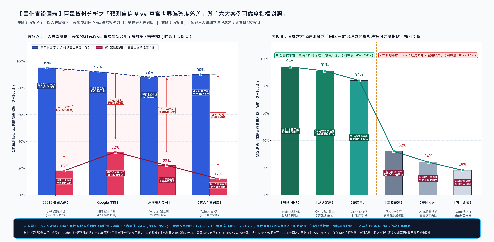
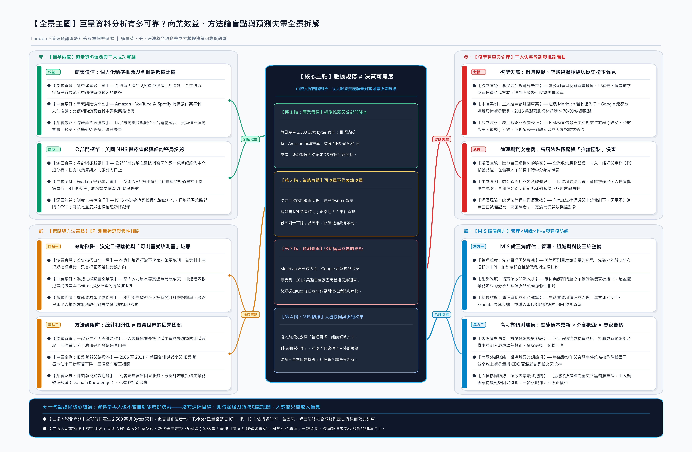
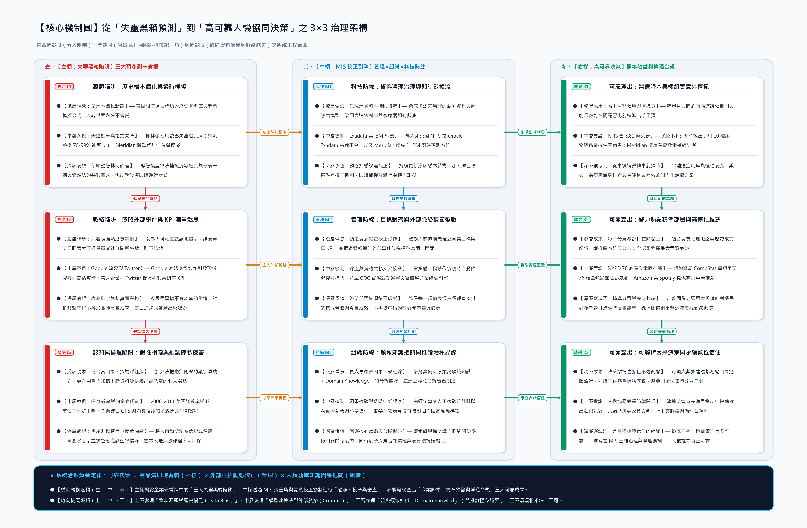

# 資訊管理（MIS）課程個案分析報告：巨量資料分析有多可靠？

- **副標題**：Big Data Analytics：商業決策效益、演算法偏見、預測模型盲點與推論隱私界線之深度解析
- **教材出處**：Laudon & Laudon《管理資訊系統（Management Information Systems）》第 6 章個案研究（頁 242–244）
- **指導老師**：何政勳 老師
- **報告成員**：
  - **楊亞恩**（學號：`311157139`｜主要負責：撰寫個案分析及報告、統整圖表與結構化對照表、上台報告｜貢獻度：**60%**）
  - **黃宥丞**（學號：`311357109`｜主要負責：資料收集、跨國案例脈絡整理、五題個案討論與 Q&A 研擬、上台報告｜貢獻度：**40%**）

---

## 執行摘要（Executive Summary）

- **● 【核心命題：數據規模 ≠ 決策可靠度】**：全球每日產生高達 **2,500 萬億位元組（2.5 Quintillion Bytes）** 的巨量資料，企業期盼藉此全面升級決策品質；然而本個案揭示，巨量資料分析唯有在「目標清晰、資料乾淨、脈絡完整且具備領域知識」的前提下才具備高可靠度，盲目跟風只會放大偏見並造成資源虛耗。
- **● 【正向標竿：精準推薦與公部門巨額效益】**：Amazon、YouTube 與 Spotify 透過客戶興趣與購物歷史提供數百萬筆個人化推薦；英國國民保健署（NHS）運用 **Oracle Exadata Database Machine** 分析數十億筆處方與臨床數據，成功**節省約 5.81 億英鎊（約 7.84 億美元）**並優化癌症治療；紐約市警局（NYPD）則透過 **CompStat 計畫**每週動態彙整 **76 個轄區**犯罪熱點並由犯罪策略部門（CSU）積極起訴重度累犯。
- **● 【反向警訊：五大盲點與三大預測翻車教訓】**：許多企業陷入「可測量就該測量」的迷思（如某大公司誤將 **Twitter 提及次數**列為銷售 KPI 導致產出大量無效線索）與「假性相關」陷阱（如 **2006–2011 年美國各州謀殺率與 IE 瀏覽器市佔率同步下降**）。在預測模型上，紐澳 **Meridian Energy** 因過時模擬無法預警機組停擺（後換裝 **IBM 即時預測系統**）、**Google 流感趨勢（GFT）**因忽略媒體恐慌搜尋脈絡而大幅高估疫情、**2016 美國總統大選**（預測柯林頓勝率 **70%～99%** 卻敗選）與 **英國脫歐公投**則因盲信歐巴馬時期舊資料庫與忽略最後一刻轉向者而集體翻車；此外，跨資料源探勘更引爆「**推論隱私（Inferential Privacy）**」（如推論早期帕金森氏症徵兆與無意識色彩偏好）之倫理法規危機。

---

## 第一章：個案國別及產業簡介

### 1.1 跨國地理版塊：從英美公部門標竿到紐澳能源與全球平台

本個案「巨量資料分析有多可靠？」探討的地理範疇橫跨全球多個主要國家與地區，充分顯示巨量資料分析（Big Data Analytics）已成為跨越國界的當代管理核心趨勢。隨著社群媒體、搜尋引擎、物聯網感應器與傳統交易系統的全面普及，全世界每天產生高達 **2,500 萬億位元組（Bytes）** 的龐大資料量。為了降低閱讀時多個國家與多起事件交錯出現的認知負荷，我們小組將個案涵蓋的地理空間系統性歸納為**「英國（UK）」、「美國（USA）」、「紐西蘭與澳洲地區」以及「跨國／全球數位服務」**四大核心板塊。在英國板塊，個案一方面呈現英國國民保健署（NHS）運用醫療大數據每年省下數億英鎊的卓越成效，另一方面也點出 2016 年 6 月英國脫歐（Brexit）公投前夕民調預測與真實結果大相逕庭的錯愕；在美國板塊，則涵蓋紐約市警局（NYPD）76 個轄區的 CompStat 犯罪熱點計畫、美國各州謀殺率與瀏覽器市佔率之統計分析、美國疾病管制中心（CDC）與 Google 流感趨勢（GFT）的疫情監測對比，以及 2016 年美國總統大選希拉蕊・柯林頓與唐納・川普的競選大數據對決；而在南半球的紐澳地區，則聚焦於跨紐西蘭與澳大利亞經營發電與配電業務的 Meridian Energy Ltd. 在大型電力設備維護預測系統上的失敗與轉型經驗。

### 1.2 多元產業應用脈絡：橫跨商業行銷、公共服務、能源公用與政治民調

在產業簡介方面，本個案深刻展現了巨量資料在六大異質產業的應用深度與伴隨而來的管理挑戰。首先是**跨國電子商務、影音音樂串流與線上比價服務業**，以 Amazon、YouTube 和 Spotify 為代表，透過即時分析客戶興趣與過往購物、觀看及聆聽歷史等巨量資料，向全球用戶提供數百萬筆高度精準的個人化推薦，成為推動公司業務蓬勃發展的核心引擎；同時，眾多線上比價平台也運用大數據協助消費者在購買汽車、電腦、手機資費方案、服裝、機票與飯店住宿時快速找出全網最低價格。其次是**公共醫療保健與臨床醫學產業**，英國 NHS 與醫療機構將數十億筆病患紀錄、處方籤與治療有效性資料存入高速資料庫機器中進行關聯分析，不僅大幅削減醫療浪費，更針對慢性病、常見病與癌症找出最具成本效益的治療方案與個人化護理建議。第三則是**公共安全與警政執法部門**（紐約市警局犯罪熱點部署與重度累犯追訴）、**能源與電力公用事業**（紐澳 Meridian Energy 發電機組維護，並涉及 Oracle 與 IBM 等企業級軟硬體供應商）、**資訊科技與公共衛生防疫**（Google 搜尋演算法與美國 CDC 疫情監測），以及**政治競選、公共民意調查與金融信貸風險管理**等領域，全面勾勒出當代組織導入大數據分析的跨產業生態全貌。

| 國別／地理板塊 | 代表組織或個案事件 | 所屬產業與部門領域 | 巨量資料核心應用場景與探討議題 | 個案成效性質 |
| :--- | :--- | :--- | :--- | :---: |
| **跨國／全球** | Amazon、YouTube、 Spotify 與線上比價網 | 電子商務、影音串流 與線上比價服務業 | ● **【精準行銷與比價】**：分析客戶興趣與購物歷史提供數百萬筆個人化推薦；協助消費者搜尋汽車、電腦、手機方案、機票與飯店最低價。 | **標竿成功** |
| **英國（UK）** | 英國國民保健署 （NHS）與醫療機構 | 公共醫療保健與 臨床醫學產業 | ● **【臨床優化與降本】**：以 `Oracle Exadata` 高速分析數十億筆病患與處方資料，省下 **5.81 億英鎊**，找出併用 10 種藥物與過量抗生素患者並優化癌症治療。 | **標竿成功** |
| **美國（USA）** | 紐約市警局（NYPD） CompStat 計畫 | 公共安全與 警政執法部門 | ● **【犯罪熱點精準執法】**：彙整全市 **76 個轄區**報案、逮捕與傳喚資料庫，每週動態呈現犯罪熱點地圖以部署警力，並由犯罪策略部門（CSU）積極起訴累犯。 | **標竿成功** |
| **跨國企業** | 某大型企業 （實體貿易展銷型） | 傳統 B2B 製造／ 貿易商業領域 | ● **【KPI 測量迷思】**：過往銷售仰賴實體貿易展與研討會，卻耗資建儀表板將官網流量與 **Twitter 提及次數**列為銷售 KPI，扭曲業務焦點並產出大量無效線索。 | **策略失敗** |
| **紐澳地區** | Meridian Energy Ltd. 發電與配電公司 | 能源與電力 公用事業產業 | ● **【設備預測轉型】**：原設備維護老化預測軟體因建模技術過時與模擬脫節無法預警真實停擺；後淘汰舊系統，換裝串接即時運行數據之 **IBM 預測軟體**。 | **先敗後成** |
| **美國（USA）** | Google 流感趨勢（GFT） vs. 美國疾管中心（CDC） | 資訊科技業與 公共衛生防疫領域 | ● **【缺乏上下文脈絡】**：透過搜尋位置與關鍵字預測流感感染率，卻忽略媒體報導炒作與社群推波助瀾引發的群眾恐慌搜尋脈絡，較 CDC 實際數據持續大幅高估。 | **預測失準** |
| **美國／英國** | 2016 美國總統大選、 2016 英國脫歐公投 | 政治競選工程與 公共民意調查產業 | ● **【歷史樣本偏見】**：柯林頓團隊盲信歐巴馬時期資料庫，誤認婦女、少數族裔與藍領將延續支持，忽略最後一刻轉向者，雖預測勝率 **70%～99%** 最終卻敗選。 | **預測翻車** |
| **跨國／全球** | 消費零售與金融信貸 資料探勘企業 | 零售行銷、金融風控 與法規倫理領域 | ● **【推論隱私侵害】**：探勘購物習慣、收入與行動裝置 GPS 軌跡標註「高風險者」，更跨源推論出**帕金森氏症早期徵兆**與無意識藍綠偏好，引發嚴重隱私危機。 | **倫理爭議** |

---

## 第二章：問題識別（該公司／組織發生什麼事）

### 2.1 四大問題叢集：從盲目啟動、假性相關到預測翻車與隱私越界

儘管巨量資料分析在電商推薦、英國 NHS 與紐約市警局展現了令人矚目的效益，但本個案更核心的教學價值，在於敏銳識別出多個企業與機構在導入巨量資料時發生的嚴重失靈事件。經過我們小組深入梳理，個案中的問題並非單一技術故障，而是涵蓋**「策略與 KPI 錯置」、「方法論因果誤判」、「預測模型偏見與脈絡缺失」以及「社會倫理與推論隱私侵害」**四大層面的系統性危機。首先，在策略目標與資料品質層面，許多公司被大數據的美麗願景誘惑，在尚未設定清晰企業目標與關鍵績效指標（KPI）、甚至連內部混亂資料都未妥善清理與治理的情況下便倉促投入。個案中某大型企業便發生典型的**「測量迷思（可測量不代表就應該測量）」**：該公司過去的實際銷售業績主要來自參加實體貿易展與專業研討會，管理層卻為了衡量網站流量與 Twitter 被提及次數的關係而建立數位儀表板，並將 Twitter 提及次數列為銷售 KPI；結果導致銷售部門徹底偏離核心業務，將寶貴時間與資源虛耗於監測網站點擊率與社群流量，最終只產出大堆永遠無法轉化為真實營收的無效銷售線索。

其次，在分析方法論與工程預測層面，組織頻繁跌入**「相關性不等於因果關係」**的邏輯陷阱與建模過時困境。例如大數據分析發現 **2006 年至 2011 年間美國各州的謀殺率與 Internet Explorer（IE）瀏覽器的市場佔有率呈現極高度正相關（兩者均顯著下降）**，但兩者之間顯然毫無實質因果聯繫；若資料分析師缺乏特定業務領域知識（Domain Knowledge），極易將巧合當成決策依據。而在實體工業界，紐澳電力公司 **Meridian Energy** 原本使用一套設備維護老化預測軟體來預測發電機、風力渦輪機、變壓器、斷路器及工業電池的維護需求，但該軟體採用過時的建模技術，僅依賴不同情境的模擬測試，根本無法準確預警真實世界中哪個設備會停擺，迫使公司最終全面淘汰舊系統並換裝導入即時數據的 IBM 軟體。

第三，在公共衛生與政治競選領域，**Google 流感趨勢（GFT）**與 **2016 年美英重大選舉民調**則雙雙發生高知名度的大數據預測翻車事件。Google 試圖透過人們的地理位置與搜尋流感相關資訊的次數來預測全美流感傳播，結果與美國疾管中心（CDC）實際數據相比卻持續大幅高估感染率；主因在於當年媒體廣泛報導流感疫情嚴重並經社群媒體推波助瀾，使許多沒生病的民眾因恐慌而上网搜尋，但 Google 的演算法「只看數字、不看搜尋結果的上下文（Context）」。同樣地，在 2016 年美國總統大選中，所有主流預測皆預言希拉蕊・柯林頓有 **70% 至 99%** 的機率擊敗川普，結果卻完全相反；這是因為柯林頓團隊高度依賴歐巴馬 2008 與 2012 年勝選時建立的龐大資料庫，錯誤假設過去支持歐巴馬的族群（婦女、少數民族、大學畢業生和藍領工人）會無條件支持柯林頓，且預測模型缺乏解釋潛在環境背景誤差的能力，未能捕捉「最初拒絕投給川普、但在最後一刻改變想法的共和黨人」以及誰會真正走進投票所，同年 6 月英國脫歐公投也出現同樣的民調失靈。最後，在資安與隱私層面，企業透過購物習慣、收入、嗜好與手機 GPS 移動路徑將民眾貼上信貸或健康「高風險者」標籤，甚至跨資料源推論出當事人自己都不知道的**帕金森氏症早期徵兆**或**無意識受藍色、綠色產品吸引**，在欠缺法律保護與抗辯機制下嚴重侵害公民權益。

### 2.2 個案六大問題發生主體與核心失靈成因診斷表

為了直觀對照上述問題發生主體、具體事件與背後的管理及方法論病根，以下結合上方量化實證圖表（面板 A 揭示未經校正的模型從 95% 表象自信崩跌至 14% 真實有效率；面板 B 對比六大組織可靠度指數），將個案識別出的六大負面與爭議事件整理為結構化診斷矩陣：

| 問題發生主體（國別） | 問題類型歸納 | 該組織／系統發生之具體事件（發生什麼事） | 核心盲點與失靈成因深度診斷 |
| :--- | :--- | :--- | :--- |
| **某大型 B2B 企業** （跨國企業） | **策略目標缺失與 KPI 測量迷思** | ● **【錯置社群儀表板】**：建立數位儀表板即時顯示官網流量與 Twitter 被提及次數，並將 Twitter 提及次數列為銷售部門關鍵績效指標（KPI）。 | ● **【背離真實業務動能】**：忽視公司過往銷售成果主要來自實體貿易展與研討會；誤以為「可測量就該測量」，耗費資源監測點擊率卻只產出大量無效銷售線索。 |
| **美國各州統計分析** （美國 USA） | **方法論陷阱： 假性相關誤判** | ● **【巧合數據高度相關】**：巨量資料分析顯示 2006 至 2011 年間，美國各州謀殺率與 Internet Explorer（IE）市佔率同步顯著下降、呈現高度相關。 | ● **【缺乏業務領域知識】**：大數據極擅長檢測細微相關性，但無法證明因果關係；分析師若缺乏解決問題的企業領域知識（Domain Knowledge），必遭假相關誤導。 |
| **Meridian Energy** （紐西蘭／澳洲） | **預測模型技術過時 與脫離真實環境** | ● **【設備預警全面失靈】**：原採用設備維護老化預測軟體監測發電機、風力渦輪機、變壓器、斷路器與工業電池，卻無法預測真實世界哪個設備會停擺。 | ● **【依賴靜態模擬缺即時流】**：舊軟體使用過時建模技術與脫離現實的情境模擬測試；後被迫捨棄舊系統，全面替換為串接更多設備即時資料的 IBM 預測軟體。 |
| **Google 流感趨勢** （美國 USA） | **演算法偏見與 缺乏上下文脈絡** | ● **【疫情數據持續高估】**：將用戶位置與 Google 搜尋流感關鍵字進行關聯分析以估算全美染病人數，但相較於美國疾管中心（CDC）數據卻持續大幅高估。 | ● **【只看搜尋量忽略媒體恐慌】**：模型建立在「搜尋流感＝感染流感」的錯誤假設上；演算法只查看搜尋數字，卻忽略媒體廣泛報導與社群推波助瀾引發的恐慌搜尋脈絡。 |
| **2016 美國總統大選 與英國脫歐公投** （美國／英國） | **歷史資料偏見與 環境誤差失察** | ● **【主流預測集體翻車】**：所有主要預測皆預言柯林頓勝選機率達 **70%～99%**（威斯康辛州民調亦遙遙領先），開票卻由川普勝出；英國脫歐民調亦大相逕庭。 | ● **【盲信舊資料庫與漏算轉向者】**：柯林頓沿用歐巴馬勝選資料庫，誤認婦女、少數民族、大學畢業生與藍領必延續支持；模型缺環境誤差校正，漏算最後一刻轉向的共和黨人。 |
| **消費零售與金融 資料探勘企業** （跨國／全球） | **資訊安全危機與 推論隱私侵害** | ● **【暗中分群與跨源推論】**：蒐集購物習慣、收入、嗜好、住所與手機移動路徑，將人標示為信貸或健康「高風險者」，更推論出**帕金森氏症早期徵兆**與藍綠偏好。 | ● **【欠缺法律程序與反擊機制】**：跨資料源拼湊出當事人不願揭露甚至自身未知的「推論隱私（Inferential Privacy）」，在無法律保護與不知情下使公民蒙受嚴重損害。 |

---

## 第三章：個案簡介

### 3.1 全文邏輯架構：從海量數據的美麗願景到可靠性與倫理的深層反思

本個案「巨量資料分析有多可靠？」出自 Laudon《管理資訊系統》第 6 章（資料庫與資訊管理），旨在帶領管理決策者全面審視當代組織運用巨量資料分析進行決策時的**商業價值、策略侷限、預測模型盲點以及倫理隱私界線**。全文採「先立後破、由淺入深」的辯證結構展開：前半段先描繪全球每日產生 **2,500 萬億位元組**資料的宏觀浪潮，並舉出電子商務與串流平台（Amazon、YouTube、Spotify 數百萬筆個人化推薦與線上比價網最低價搜尋）、公共醫療保健（英國國民保健署 NHS 以 `Oracle Exadata Database Machine` 高速分析數十億筆處方與臨床資料，省下 **5.81 億英鎊／7.84 億美元**，建立儀表板揪出同時服用 **10 種藥物**與過量抗生素患者，並編譯癌症數據優化治療）以及公共安全執法（紐約市警局推動 **CompStat 計畫**，每週動態呈現 **76 個轄區**犯罪熱點以精準部署警力，並由犯罪策略部門 CSU 起訴重度累犯）三大領域的卓越成功實踐，證明當組織目標明確且基礎設施完善時，巨量資料確實能大幅改善經營績效與公共福祉。

然而，個案後半段筆鋒一轉，深入剖析為什麼「在一堆資料中打滾並不意味著正在蒐集正確資訊或能做出更明智的決策」。作者依序揭露了企業急於啟動專案卻未設目標與未清理資料的盲點、誤把 Twitter 提及次數列為銷售 KPI 的「測量迷思」、把「2006–2011 年美國謀殺率與 IE 市佔率同步下降」混為一談的「假性相關陷阱」，接著透過紐澳 **Meridian Energy** 淘汰過時預測軟體改採 IBM 即時系統、**Google 流感趨勢（GFT）**因忽略媒體報導脈絡而高估疫情、以及 **2016 年美國總統大選與英國脫歐公投**因歷史資料偏見與忽略最後一刻轉向選民而集體翻車等三大經典案例，證明預測模型若缺乏即時數據、上下文脈絡（Context）與人類領域知識（Domain Knowledge），將隨時面臨失準風險。文末更進一步對齊第 4 章倫理議題，警示企業結合行動裝置 GPS 與多源個資標註「高風險者」、甚至推論出**帕金森氏症早期徵兆**與無意識色彩偏好的「推論隱私」危機，為讀者建立起兼顧商業效益、方法論嚴謹度與法規倫理的完整 MIS 決策觀。

### 3.2 個案四大核心構面雙欄對齊總覽

配合上方全景結構主圖（圖 2），可將本個案全篇脈絡精煉為四大核心構面：

- **構面一：海量數據商業機會與公部門標竿實踐（正向價值）**
  - ● **【商業個人化推薦與比價】**：Amazon、YouTube、Spotify 透過客戶興趣與購物歷史提供數百萬筆個人化推薦；線上服務助消費者找汽車、電腦、手機方案、機票與飯店最低價。
  - ● **【英國 NHS 醫療大數據降本】**：將數十億筆病患與處方資料存放於 `Oracle Exadata`，省下 **5.81 億英鎊**，找出併用 10 種藥物與過量抗生素患者，並優化癌症與慢性病治療。
  - ● **【紐約警局 CompStat 精準執法】**：彙整全市 **76 個轄區**報案、逮捕與傳喚資料庫，每週呈現犯罪熱點協助指揮官部署警力，並由犯罪策略部門（CSU）積極追訴重度累犯。
- **構面二：策略盲點、資料品質與方法論陷阱（內部侷限）**
  - ● **【無目標盲目投入與混亂資料】**：許多公司被大數據美麗願景誘惑而未先設定企業目標與 KPI；組織絕不可能從未妥善清理、組織與管理的混亂資料中獲益（資料品質至關重要）。
  - ● **【可測量不代表該測量的迷思】**：某大公司忽視自身銷售源自實體貿易展與研討會，建儀表板把 Twitter 提及次數列為銷售 KPI，扭曲銷售焦點並產出大量無效銷售線索。
  - ● **【相關性不等於因果關係】**：大數據雖擅長檢測細微相關性（如 2006–2011 美國謀殺率與 IE 市佔率同步下降），但無法證明因果關係，分析師必須具備企業領域知識（Domain Knowledge）。
- **構面三：預測模型失靈之三大跨國教訓（外部與動態盲點）**
  - ● **【紐澳 Meridian 建模技術過時】**：原設備維護老化預測軟體依賴過時建模與脫離現實的模擬測試，無法預警真實世界哪個發電設備會停擺，後換裝串接即時資料的 IBM 預測軟體。
  - ● **【Google 流感趨勢忽略媒體脈絡】**：僅關聯地理位置與流感搜尋量，忽略媒體廣泛報導與社群推波助瀾引發的群眾恐慌搜尋上下文（Context），導致較 CDC 實際數據持續高估。
  - ● **【2016 美國大選與英國脫歐翻車】**：柯林頓團隊盲信歐巴馬勝選資料庫，誤認婦女、少數民族、大學畢業生與藍領必延續支持，忽略最後一刻轉向的共和黨人，使 70%–99% 勝率預測翻車。
- **構面四：演算法貼標籤與推論隱私侵犯爭議（社會與法規邊界）**
  - ● **【行動軌跡探勘與高風險標註】**：企業積極蒐集購物習慣、收入、嗜好、住所與手機移動路徑，透過細小線索將人們分群並標示為貸款或健康「高風險者」以保護企業或操弄消費者。
  - ● **【跨源拼湊之推論隱私危機】**：將個資結合不同來源資料後，能推論出當事人不願揭露甚至自己都不知道的特徵（如**顯示出帕金森氏症早期徵兆**，或無意識受藍色、綠色產品吸引）。
  - ● **【欠缺法律程序與抗辯保護】**：隱私專家擔憂在沒有法律程序保護、缺乏反擊機制、當事人甚至不知道自己已被分類貼標籤的情況下，公民與消費者將蒙受嚴重損害。

---

## 第四章：個案研究問題的小組討論後回答（共 5 題完整深度解析）

> **本章研討說明**：為完全符合課程規範「**4. 個案問題題目數需滿足 5 題之分析及討論，請聚焦於該章節（第 6 章：資料庫與資訊管理／商業智慧與巨量資料分析）的議題**」，以下依序針對課本原附 4 題及聚焦本章預測模型核心議題之第 5 題延伸進階題，呈現我們小組深度討論後的完整回答。

---

### 問題 1：個案中所提到組織能從巨量資料分析中獲得哪些企業效益？

經過我們小組討論與彙整個案內容後，我們認為當組織具備明確目標與適當的分析平台時，能從巨量資料分析中獲得**「商業營收與顧客體驗提升」、「醫療保健成本節省與臨床精準化」以及「公共安全執法與跨產業營運優化」**三大層面的具體企業與組織效益：

1. **商業行銷與消費者服務層面：大規模個人化推薦與全網最低價比價**
   - **● 【帶動數位平台營收蓬勃發展】**：如同 **Amazon、YouTube 和 Spotify** 等跨國企業，透過分析所蒐集到的客戶興趣、瀏覽行為與購物歷史等巨量資料，能即時向用戶提供**數百萬筆高度精準的個人化推薦**，大幅提高客戶黏著度與購買轉化率，進而讓公司蓬勃發展。 Even in electoral campaigns, **唐納・川普（Donald Trump）競選團隊**也運用巨量資料分析，針對不同選民群體量身打造精準的廣告訊息。
   - **● 【賦能消費者做出最佳購買決策】**：許多線上比價服務正運用巨量資料分析，幫助消費者在尋找**汽車、電腦、手機資費方案、服裝、機票以及飯店住宿**等商品或服務時，快速比對並找出市場上的最低價格。
2. **醫療保健與臨床醫學層面：巨額支出節省、用藥安全監控與個人化治療**
   - **● 【節省高達 5.81 億英鎊醫療支出】**：**英國國民保健署（NHS）**將數十億筆病患、醫療保健提供者、處方籤與治療方式有效性資料存放在高速運算平台 `Oracle Exadata Database Machine` 中進行快速分析，成功為國家醫療體系**節省約 5.81 億英鎊（約 7.84 億美元）**。
   - **● 【即時儀表板監控與最佳治療方案】**：NHS 利用分析成果建立數位儀表板，精準找出**一次同時服用 10 種藥物的患者**以及**正在服用過量抗生素的患者**以防範醫療風險；同時大量編譯**癌症用藥與治療結果數據**並串連患者資訊，找出更有效的癌症治療方案。此外，各大醫療保健公司也正透過分析巨量資料，針對**慢性病和常見病**找出最有效且最省錢的治療方式，並提供**個人化的護理建議**給病人。
3. **公共安全執法與跨產業營運層面：精準警力部署、設備預測維護與風險識別**
   - **● 【動態犯罪熱點追蹤與累犯起訴】**：**紐約市警局（NYPD）**推動 `CompStat` 犯罪地圖計畫，彙整全市 **76 個轄區**的報案或投訴、逮捕、法院傳喚資料庫，每週呈現各轄區、巡邏區及全市犯罪與逮捕資訊。這不僅幫助轄區指揮官快速找出犯罪樣式與趨勢、**將警力精準佈署至最需要的熱點**，更協助紐約市**犯罪策略部門（Crime Strategies Unit, CSU）**鎖定嚴重違法者積極起訴，實質降低犯罪率。
   - **● 【工業設備即時預警與多元領域擴散】**：在能源公用事業中，紐澳 **Meridian Energy** 換裝 **IBM 的維護和品質預測軟體**後，得以運用發電機、風力渦輪機、變壓器等設備的**即時資料**準確預測維護需求；此外，巨量資料分析也為**運動賽事、教育、科學研究**以及企業透過細小線索將客戶分群、**識別信貸或健康「高風險者」以保護企業利益**帶來顯著效益。

---

### 問題 2：找出個案中組織透過巨量資料分析而改善的兩個決策，以及沒有改善（或失敗）的兩個決策。

在透過巨量資料分析而**成功改善的決策**方面，我們小組選出的第一個案例是**「英國國民保健署（NHS）的臨床用藥安全監控與癌症治療優化決策」**，第二個案例則是**「紐約市警局（NYPD）CompStat 計畫的警力動態部署與重度累犯追訴決策」**（此外，Amazon/Spotify 的個人化推薦決策以及 Meridian Energy 後期換裝 IBM 即時預測軟體的設備維護決策亦屬成功改善案例）。NHS 過去面對數十億筆分散的病患與處方紀錄難以即時統整，在導入 `Oracle Exadata Database Machine` 建立分析儀表板後，醫療決策者得以精準識別出同時服用 10 種藥物的高風險患者與過量使用抗生素者，並串連癌症臨床數據找出最佳治療方案，實質省下 5.81 億英鎊；而紐約市警局則透過 CompStat 每週彙整 76 個轄區的報案與逮捕數據，讓轄區指揮官不再憑經驗盲目派警，而是根據即時犯罪熱點與趨勢精準佈署警力，並由犯罪策略部門（CSU）主動起訴嚴重違法者。

在**沒有改善（或失敗）的決策**方面，我們小組選出的第一個案例是**「某大型企業將 Twitter 提及次數列為銷售關鍵績效指標（KPI）的行銷資源配置決策」**，第二個案例則是**「2016 年美國總統大選希拉蕊・柯林頓競選團隊的選情預測與選區資源投入決策」**（此外，Meridian Energy 早期採用過時設備老化模擬軟體的維護決策，以及 Google 流感趨勢 GFT 僅依賴搜尋量預估疫情的防疫預測決策，同樣是典型的失敗案例）。某大型企業過去的真實銷售業績主要來自實體貿易展與專業研討會，卻盲目建立數位儀表板監控官網流量與 Twitter 被提及次數並設為銷售 KPI，導致銷售部門把時間與資源轉移去追蹤點擊率與社群流量，最終只產出大量永遠不會創造真正銷售的無效線索；而柯林頓團隊則過度依賴歐巴馬勝選時的歷史資料庫，錯誤假設婦女、少數民族、大學畢業生與藍領工人會無條件延續支持，並將競選焦點放在選民投票率很高的地區，卻忽略了最後一刻改變想法的共和黨選民與威斯康辛州等地的潛在環境誤差，導致預測模型雖估算勝率高達 70% 至 99%，最終卻在真實大選中敗北。

| 決策成效分類 | 代表組織（國別） | 巨量資料分析工具與具體決策內容 | 最終決策結果與實質組織影響 |
| :---: | :--- | :--- | :--- |
| **成功改善決策 1** | **英國國民保健署 NHS** （英國 UK） | ● **【臨床用藥與癌症治療決策】**：使用 `Oracle Exadata Database Machine` 高速分析數十億筆病患、處方籤與治療有效性資料，建立即時醫療儀表板。 | ● **【省下 5.81 億英鎊並提升療效】**：成功找出一次服用 10 種藥物與過量抗生素患者，串連癌症用藥數據找出更有效治療方案，節省約 5.81 億英鎊（7.84 億美元）。 |
| **成功改善決策 2** | **紐約市警局 NYPD** （美國 USA） | ● **【警力熱點部署與累犯追訴決策】**：透過 `CompStat` 犯罪地圖計畫彙整全市 76 個轄區之報案、投訴、逮捕與法院傳喚資料庫，每週動態分析犯罪熱點。 | ● **【精準佈署警力並降低犯罪率】**：協助轄區指揮官快速辨識犯罪樣式與趨勢，針對最需要的地方佈署警察，並由犯罪策略部門（CSU）積極起訴嚴重違法者。 |
| **沒有改善／ 失敗決策 1** | **某大型企業** （跨國實體展銷企業） | ● **【將 Twitter 聲量列為銷售 KPI 決策】**：為衡量網站流量與 Twitter 被提及次數的關係而建立數位儀表板，並將 Twitter 提及次數設定為銷售部門關鍵績效指標。 | ● **【扭曲銷售焦點並虛耗資源】**：背離過往仰賴實體貿易展與研討會的銷售模式，使銷售部門耗費時間監測網站點擊與社群流量，產生大量無法創造真正銷售的無效線索。 |
| **沒有改善／ 失敗決策 2** | **2016 柯林頓競選團隊** （美國總統大選） | ● **【盲信歷史資料庫之選區聚焦決策】**：加入歐巴馬 2008/2012 勝選資料庫分析民調、社群貼文與線上行為，假設舊支持族群不變，將焦點放在高投票率地區。 | ● **【勝率估 70%–99% 卻意外敗選】**：婦女、少數民族、大學畢業生與藍領未如預期支持，且模型未納入最後一刻轉向川普的共和黨人，導致威斯康辛州等地預測徹底失準。 |

---

### 問題 3：說明使用巨量資料的限制。

根據個案內容與我們小組的深度剖析，巨量資料分析並非萬靈丹；組織在使用巨量資料進行商業與管理決策時，面臨以下**五大核心限制與盲點**：

1. **缺乏清晰企業目標與「可測量就代表該測量」的 KPI 迷思**
   - **● 【盲目跟風跳入資料堆】**：許多公司被巨量資料分析的美麗願景所誘惑，急於啟動分析計畫，卻沒有先設定清晰的企業目標或建立衡量成敗的關鍵績效指標（KPI）。在一堆資料中打滾並不意味著正在蒐集正確資訊或能做出更明智的決策。
   - **● 【錯誤指標扭曲組織行為】**：「某件事可以測量，並不意味著就應該測量。」如同某大公司把容易測量的 Twitter 提及次數與網站流量設為銷售 KPI，反而讓銷售團隊放棄真正能帶來業績的實體貿易展與研討會，產出大量毫無價值的無效銷售線索。
2. **資料品質與資料治理限制（Garbage In, Garbage Out）**
   - **● 【混亂資料無法產生商業價值】**：個案明確警告，組織**絕對不會從未正確清理、組織、管理的巨量資料中獲益**。當企業蒐集了龐大卻充滿雜訊、格式不一致或未經治理的資料時，分析結果只會誤導決策——**資料品質至關重要**。
3. **方法論限制：擅長找相關性，但「相關性不等於因果關係」**
   - **● 【假性相關（Spurious Correlation）陷阱】**：巨量資料分析非常擅長檢測微小資料集容易漏掉的細微相關性，但它**不一定能找出因果關係，或判斷該相關性是否有意義**。例如 2006 年至 2011 年美國各州謀殺率與 Internet Explorer（IE）市場佔有率同步顯著下降、呈現高度相關，但兩者之間毫無實質聯繫；若分析師缺乏解決問題的**企業領域知識（Domain Knowledge）**，就會做出荒謬推論。
4. **預測模型限制：過時建模技術、資料選擇偏見與缺乏上下文脈絡（Context）**
   - **● 【過時建模與脫離真實環境】**：如紐澳 Meridian Energy 早期使用的設備維護老化預測軟體，因採用過時建模技術與脫離現實的情境模擬，雖能預測設備何時無法通過模擬測試，卻無法準確預測真實世界中哪個發電設備會停擺。
   - **● 【忽略搜尋與行為背後的上下文脈絡】**：所有資料集與預測模型都反映了人們選擇資料與執行分析的偏見。Google 流感趨勢（GFT）只查看搜尋數字，卻忽略媒體廣泛報導疫情與社群推波助瀾引發的群眾恐慌搜尋上下文（Context），導致持續高估流感感染率。
   - **● 【歷史樣本僵化與環境誤差失靈】**：2016 年美國大選與英國脫歐公投證明，過度依賴過往歷史資料庫（如歐巴馬時期選民資料）、假設過去支持者會無條件延續，且缺乏解釋潛在環境背景誤差與捕捉「最後一刻改變想法者」及「誰會真正去投票」的能力，會讓高達 70%～99% 的勝率預測徹底翻車。
5. **資訊安全、倫理與「推論隱私（Inferential Privacy）」侵害限制**
   - **● 【黑箱分群貼標籤與無意識操控】**：企業積極蒐集人們的購物習慣、收入、嗜好、住所及行動裝置移動路徑，將部分人自動標示為貸款或健康上的「高風險者」，甚至將個資結合不同來源資料，推論出當事人不願揭露或自己都不知道的事實線索（如**早期帕金森氏症徵兆**、或**無意識受藍色或綠色產品吸引**）。在缺乏法律程序保護、缺乏反擊機制且當事人毫不知情下，極易造成嚴重的公民權益侵害與法規合規風險。

---

### 問題 4：所有的組織都應該蒐集和分析巨量資料嗎？在公司決定要投入巨量資料分析前，必須先考量哪些管理、組織和科技的議題？

經過我們小組深入討論後，我們的明確結論是：**「並非所有的組織都應該盲目蒐集和分析巨量資料。」** 如果一家企業只是被巨量資料的美麗願景所誘惑，卻尚未釐清自身要解決的核心營運問題、沒有設定清晰的企業目標與正確 KPI，或者其核心業務動能根本不依賴特定的線上表象數據（例如個案中依靠實體貿易展與專業研討會創造銷售額的傳統 B2B 企業），甚至連基本的資料清理與治理能力都還不具備，那麼倉促投入巨量資料分析不僅無法獲益，反而會扭曲部門工作焦點、浪費龐大軟硬體與人力預算，並產出大量無效線索。

當公司評估自身業務確實需要、並決定要正式投入巨量資料分析前，必須依據資訊管理系統（MIS）核心的**「管理（Management）、組織（Organization）、科技（Technology）鐵三角架構」**，預先審慎考量以下三大維度的關鍵議題：

- **一、管理維度（Management Issues）：目標對齊、KPI 設計與隱私倫理治理**
  - **● 【預先設定清晰企業目標與問題定義】**：管理層在啟動專案前，必須先回答「我們要透過巨量資料解決什麼具體的企業問題或營運瓶頸？」（如英國 NHS 鎖定降低處方浪費與優化癌症治療、紐約警局鎖定降低轄區犯罪率），絕不可無目標地跳入資料堆中打滾。
  - **● 【建立正確 KPI 並破除測量迷思】**：必須審慎設計衡量成功與否的關鍵績效指標（KPI），嚴格區分「容易測量的表象指標（如 Twitter 提及次數、網站點擊率）」與「真正創造商業價值的核心指標（如實體展會成交率、實質成本節省）」，避免錯誤指標誤導資源配置。
  - **● 【制定資安防護與推論隱私倫理紅線】**：管理層必須正視探勘顧客購物習慣、收入與行動軌跡所引發的隱私爭議，針對演算法自動標註「高風險者」及跨資料源「推論隱私（如推論帕金森氏症前兆）」建立內部倫理審查、資訊透明告知與消費者抗辯申訴機制，確保符合法律規範。
- **二、組織維度（Organization Issues）：領域知識人才配置與跨部門流程校準**
  - **● 【配置具備深厚企業領域知識（Domain Knowledge）的分析師】**：由於巨量資料擅長找出細微相關性卻無法證明因果關係（如 IE 市佔率與謀殺率的假性相關），組織不能只聘用純寫程式或跑統計的人員，而必須配置深諳該產業業務邏輯與社會脈絡的領域專家，以判斷相關性是否具備實質商業意義。
  - **● 【保護部門核心業務焦點不被儀表板扭曲】**：在導入新的數位儀表板或分析指標時，需重新檢視銷售與營運部門的日常工作流程與獎酬制度，確保業務團隊不會為了追求漂亮的線上互動數字而荒廢真正創造營收的核心管道。
  - **● 【建立定期檢視模型假設與跨部門協作文化】**：分析師與決策團隊必須花足夠時間檢視用於預測模型的底層資料（避免如 2016 美選分析師未充分檢視民調資料與環境誤差），打破歷史經驗主義，定期根據外部環境變遷修正組織決策假設。
- **三、科技維度（Technology Issues）：資料品質清理治理、高速運算平台與即時數據串接**
  - **● 【落實資料清理、組織與資料品質治理】**：「資料品質很重要！」在進行任何高階分析前，IT 部門必須先建立標準化的資料清理（Data Cleansing）、格式整合與主數據管理機制，確保餵入模型的資料正確、乾淨且結構良好。
  - **● 【建置能高速處理海量資料的軟硬體基礎設施】**：面對每日 2,500 萬億位元組規模的巨量資料（含結構化處方紀錄與非結構化社群、感應器資料），公司必須評估並投資高效能的資料庫與分析平台，例如英國 NHS 採用的 `Oracle Exadata Database Machine`，以支撐數十億筆資料的即時查詢與儀表板呈現。
  - **● 【淘汰過時建模軟體並串接動態即時運行數據】**：在建構預測系統時，必須檢視演算法與建模技術是否過時（借鏡紐澳 Meridian Energy 淘汰舊老化模擬軟體、換裝 **IBM 即時維護與品質預測軟體**的經驗），確保系統能串接感應器與前端業務的「即時資料（Real-time Data）」，而非僅做脫離現實的靜態情境模擬。

---

### 問題 5（延伸進階題）：結合個案中 Google 流感預測失準以及 2016 年美國總統大選預測翻車的教訓，當企業或組織在建構「預測模型」時，應該如何避免陷入「資料偏見（Data Bias）」與「缺乏上下文脈絡（Context）」的陷阱？

結合本個案中 **Google 流感趨勢（GFT）持續高估疫情**以及 **2016 年美國總統大選主流模型預測柯林頓勝率達 70%～99% 最終卻慘遭翻車**（含同年英國脫歐公投失準與紐澳 Meridian Energy 舊系統失靈）的慘痛教訓，我們小組認為：當代企業或組織在建構「資料導向的預測模型（Data-Driven Predictive Models）」時，若要避免重蹈覆轍，必須將傳統的「黑箱靜態統計模型」全面升級為**「具備動態樣本更新、外部脈絡調節與領域專家因果把關的人機協同預測架構」**。我們可將此高可靠度預測模型的設計法則收斂為以下核心關係式：

$$\text{Reliable Prediction } (\hat{Y}_t) = f_{\text{Domain}}\!\Big(\;\underbrace{D_{\text{Historical}} \oplus D_{\text{Real-Time}}(t)}_{\text{1. 破除資料偏見：動態樣本融合}},\;\; \underbrace{\frac{X_{\text{Behavioral}}(t)}{1 + \gamma \cdot C_{\text{Media/Shock}}(t)}}_{\text{2. 補足上下文脈絡：外部事件降權調節}},\;\; \underbrace{\varepsilon_{\text{Latent}}(t)}_{\text{3. 潛在環境誤差校正}}\;\Big)$$

- **公式符號白話直覺翻譯（Plain-Language Walkthrough）**：
  - **$D_{\text{Historical}} \oplus D_{\text{Real-Time}}(t)$（動態樣本融合）**：代表不能只依賴過去成功的靜態歷史資料庫（$D_{\text{Historical}}$，如歐巴馬時期選民庫），必須即時融合當下最新的動態運行數據與地面實況（$D_{\text{Real-Time}}(t)$，如 IBM 設備即時感應器數據或選前最新搖擺州抽樣）。
  - **$X_{\text{Behavioral}}(t) \,/\, [1 + \gamma \cdot C_{\text{Media/Shock}}(t)]$（外部脈絡降權調節）**：$X_{\text{Behavioral}}(t)$ 為線上表象行為數字（如 Google 流感搜尋量、Twitter 提及次數）；當外部發生媒體大幅報導炒作或社群恐慌事件（$C_{\text{Media/Shock}}(t)$ 飆升）時，模型透過調節係數 $\gamma$ 自動對表象搜尋量進行「除噪降權」，避免把「恐慌搜尋」誤判為「真實染病」。
  - **$\varepsilon_{\text{Latent}}(t)$ 與 $f_{\text{Domain}}(\cdot)$（潛在環境誤差校正与領域知識審查）**：$\varepsilon_{\text{Latent}}(t)$ 用於捕捉「最後一刻改變想法者」與「沉默選民」的隱性誤差；最外層的 $f_{\text{Domain}}$ 則代表所有統計關聯都必須通過人類專家的「特定業務領域知識（Domain Knowledge）」因果檢驗才能輸出最終決策。

具體而言，企業在建構預測模型時應落實以下**三大防範與修正對策**（對應圖 3 中欄之 M1、M2、M3 三道治理防線）：

1. **對策一：如何避免陷入「資料偏見（Data Bias）」與歷史樣本僵化陷阱？（借鏡 2016 美國大選與英國脫歐教訓）**
   - **● 【摒棄「過去結構會無條件延續到未來」的靜態假設】**：在 2016 年美國大選中，柯林頓團隊之所以誤判，是因為直接沿用歐巴馬 2008 與 2012 年勝選時建立的資料庫，主觀假設過去支持歐巴馬的婦女、少數民族、大學畢業生與藍領工人必將同樣支持柯林頓。企業建模時必須認清「過往成功樣本具有強烈的時代與情境偏見」，絕不可將歷史關聯視為永久不變的定律。
   - **● 【持續注入即時動態資料（Real-time Data）並擴充多元資料源】**：民意調查或單一歷史資料庫只是眾多參考來源之一。如同紐澳 Meridian Energy 果斷捨棄舊模擬軟體、改採串接設備即時資料的 **IBM 預測系統**，企業必須讓預測模型持續接收第一線的即時動態數據，並要求分析師花足夠時間親自檢視底層資料的抽樣代表性。
   - **● 【設計「潛在環境誤差校正」與「真實行為轉化」評估機制】**：預測模型往往無法確定「誰會真的去投票（或誰會真的掏錢購買）」。為避免威斯康辛州民調遙遙領先卻翻車的窘境，模型必須納入潛在環境背景誤差（Latent Environmental Error）的敏感度分析，針對「最初拒絕表態、但在最後一刻改變想法的群體（Late Switchers / Shy Voters）」設計滾動式加權校正。
2. **對策二：如何避免陷入「缺乏上下文脈絡（Context）」與表象指標陷阱？（借鏡 Google 流感趨勢 GFT 教訓）**
   - **● 【超越單一表象搜尋數字，探究數據生成背後的人類心理動機】**：Google 流感趨勢之所以較美國疾管中心（CDC）持續高估流感感染率，是因為演算法只看「地理位置 × 流感關鍵字搜尋量」，卻忽略了當年媒體廣泛報導疫情嚴重、加上社群媒體推波助瀾所引發的「健康民眾恐慌性搜尋與好奇搜尋」。企業建模時，絕不能直接假設「線上搜尋或提及次數 ＝ 實體世界真實需求」。
   - **● 【將「外部異常事件（媒體熱度、政策變動、公關危機）」設為調節變數】**：在建構預測模型時，應同步監測新聞媒體報導量與社群傳播熱度作為「外部脈絡指標（Contextual Covariates）」。一旦偵測到媒體炒作引發搜尋量異常暴增，系統應自動啟動降權校正（Denoising），剝離因媒體推波助瀾產生的虛假泡沫。
   - **● 【建立「線上快數據（Fast Data）× 實體慢數據（Ground Truth）」雙軌校準閉環】**：線上搜尋量與 Twitter 提及次數雖然即時，但容易失真；實體數據（如美國 CDC 的實際醫院就診通報數據、企業實體貿易展的真實訂單轉化率）雖然稍有時間滯後，卻是最可靠的真實基準（Ground Truth）。高可靠度的預測模型必須定期以實體基準數據對線上預測值進行閉環校準（Recalibration）。
3. **對策三：建立「演算法模型 × 人類專家領域知識（Domain Knowledge）」雙腦協同防線**
   - **● 【以領域知識審查因果邏輯，拒絕黑箱演算法自動導航】**：如同個案指出「2006–2011 年美國各州謀殺率與 IE 市佔率高度相關」只是毫無意義的巧合，演算法本身沒有常識。企業必須規定：任何預測模型輸出的高相關性訊號，都必須交由具備深厚**企業領域知識（Domain Knowledge）**的分析師與業務專家進行因果機理審核；一旦發現模型假設與真實世界社會脈絡脫節，人類專家便能立即介入修正參數，確保巨量資料預測真正可靠。

| 預測失靈代表案例 | 陷入之核心陷阱與盲點 | 失靈原因具體剖析（為什麼翻車？） | 企業建構預測模型之具體防範與修正對策 |
| :--- | :--- | :--- | :--- |
| **2016 美國總統大選 與英國脫歐公投民調** | **資料偏見（Data Bias）** 與歷史樣本僵化 | ● **【盲信舊資料庫與忽略轉向者】**：柯林頓團隊沿用歐巴馬 2008/2012 勝選資料庫，誤認婦女、少數民族、大學畢業生與藍領必延續支持；模型缺乏環境背景誤差解釋力，漏算最後一刻轉向川普的共和黨人與真實投票意願。 | ● **【動態樣本更新與誤差校正】**：摒棄歷史結構無條件延續的靜態假設；要求分析師嚴審底層資料代表性，結合多元即時資料源，並增設潛在環境誤差與「最後一刻轉向者／沉默群體」之滾動加權校正機制。 |
| **Google 流感趨勢 （GFT）疫情預測** | **缺乏上下文脈絡（Context）** 與表象指標誤導 | ● **【只看搜尋數字忽略媒體恐慌】**：模型假設「Google 搜尋流感資訊＝實際感染流感」，演算法只統計位置與搜尋量，卻忽略媒體廣泛報導疫情並經社群推波助瀾引發的群眾恐慌搜尋脈絡，導致較 CDC 數據持續高估。 | ● **【外部脈絡調節與雙軌校準】**：將「媒體報導熱度與社群擴散事件」設為模型的降權調節變數以過濾恐慌雜訊；並建立「線上搜尋快數據 × 美國 CDC 實體就診基準數據（Ground Truth）」之定期交叉校準閉環。 |
| **紐澳 Meridian Energy 早期設備維護系統** | **過時建模技術** 與脫離真實世界情境 | ● **【靜態情境模擬脫離現實】**：舊設備維護老化預測軟體使用過時建模技術與模擬測試，雖能預測何時無法通過模擬，卻無法準確預警真實世界中哪個發電機、風機或變壓器會停擺。 | ● **【導入即時數據與領域專家協作】**：全面淘汰脫離現實的靜態模擬模型，如同 Meridian 換裝 **IBM 維護與品質預測軟體**般串接感應器「即時運行資料」，並由具備領域知識（Domain Knowledge）的工程與業務專家把關因果邏輯。 |

---

## 第五章：成員貢獻表與 20–25 分鐘上台報告＆ Q&A 協作規劃

### 5.1 小組成員貢獻百分比明細表

在本次「資訊管理（MIS）」課程之「巨量資料分析有多可靠？」個案分析專案中，我們兩位小組成員透過密切分工與深度共同研討完成所有章節分析、科學視覺化圖譜繪製、量化圖表實證與簡報設計。由**黃宥丞**同學負責前期的課本個案與跨國背景資料收集、八大組織案例脈絡整理，並與組員共同針對五項個案研究問題進行深度討論與 Q&A 防禦題庫研擬；再由**楊亞恩**同學負責統整小組討論成果、撰寫第一章至第五章完整報告內文與結構化對照矩陣、編製全景知識圖譜與量化實證圖表，最後由兩位成員共同完成簡報編修並**全員一同上台進行 20–25 分鐘口頭報告與 25 分鐘 Q&A 答詢**。

| 姓名 | 學號 | 主要負責內容（具體分工明細） | 是否上台報告 | 貢獻百分比 |
| :---: | :---: | :--- | :---: | :---: |
| **楊亞恩** | `311157139` | ● **【報告主筆、視覺圖表統整與上半場主講】**：主導第一章至第四章之個案分析內文撰寫、跨國案例總覽表與問題識別診斷表編排、整合小組五題討論結論成文、繪製知識圖譜與簡報視覺排版，並擔任**上半場上台報告主講人**與 Q&A 共同答詢。 | **是（必上台）** | **60%** |
| **黃宥丞** | `311357109` | ● **【資料收集、個案深度討論與下半場主講】**：負責收集並整理英國 NHS、紐約警局 CompStat、紐澳 Meridian Energy、Google 流感趨勢與 2016 美選民調等案例背景資料，參與五題個案問題深度研討與 Q&A 題庫擬定，並擔任**下半場上台報告主講人**與 Q&A 共同答詢。 | **是（必上台）** | **40%** |
| **小組總計** | — | **全案五章深度報告、3 張出版級圖譜與量化圖表、11 頁原生向量簡報與 Q&A 題庫** | **全員皆上台報告** | **100%** |

### 5.2 課程規範對齊：20–25 分鐘雙講者時間配當與 25 分鐘 Q&A 防禦指南

為嚴格符合課程規範第 6 點「**每組報告為 20–25 分鐘，25 分鐘 Q&A，每位同學皆需上台報告**」，我們將同步產出的 11 頁 16:9 簡報（`02_case_analysis_presentation.pptx`）規劃為**「上半場（楊亞恩，第 1～6 頁，約 11.5 分鐘）＋ 下半場（黃宥丞，第 7～11 頁，約 11.5 分鐘）＝ 總計 23 分鐘」**的雙人黃金接力節奏，並預先準備 25 分鐘 Q&A 環節的深度應答題庫：

| 報告階段與講者 | 對應簡報頁次與章節主題 | 預計時間 | 核心演講重點與時間控制節奏 |
| :--- | :--- | :---: | :--- |
| **上半場主講： 楊亞恩** （`311157139`） | • **Slide 01–02**：封面破題、核心命題與簡報五步導覽 • **Slide 03**：(1) 個案國別及產業簡介（四大板塊×八案例矩陣） • **Slide 04**：(2) 問題識別（六大組織失靈事件與量化斷崖圖） • **Slide 05**：(3) 個案簡介（全景結構圖與四大核心構面） • **Slide 06**：(4) 問題 1（三大企業效益）與問題 2（兩大改善決策：NHS & NYPD） | **11～12 分鐘** *(約 1.9 分/頁)* | 從全球每日 `2,500 萬億 Bytes` 破題，先為全班建立跨國與跨產業全局地圖，接著對比英國 NHS（省 `5.81 億英鎊`）與紐約警局（`76 轄區`）兩大成功決策如何靠明確目標與高速平台創造實質價值。 |
| **下半場主講： 黃宥丞** （`311357109`） | • **Slide 07**：(4) 問題 2（兩大失敗決策：Twitter KPI 迷思 & 2016 美選） • **Slide 08**：(4) 問題 3（大數據五大限制：假性相關 IE 謀殺率 & 推論隱私帕金森氏症） • **Slide 09**：(4) 問題 4（所有組織都該投入嗎？MIS 管理×組織×科技鐵三角） • **Slide 10**：(4) 問題 5 進階題（GFT 與美選教訓：公式解剖與防範對策） • **Slide 11**：總結三大黃金定律與 25 分鐘 Q&A 深度探討引導 | **11～12 分鐘** *(約 2.3 分/頁)* | 接棒剖析為什麼大數據會失靈（Twitter 測量迷思、IE 假性相關、Meridian/GFT/2016 美選翻車與推論隱私侵害），最後以 MIS 鐵三角與「動態樣本＋外部脈絡＋領域知識」公式收斂全案並開啟 25 分鐘 Q&A。 |

#### 💡 25 分鐘 Q&A 環節：預期老師與同學提問之四大深度防禦應答錦囊

- **● 【Q&A 錦囊 1：既然 2016 年柯林頓與川普都用了巨量資料分析，為什麼柯林頓翻車、川普卻贏了？】**
  - **標準應答要點**：關鍵在於**「模型假設與應用目的不同」**。柯林頓團隊把大數據用在「靜態選情預測與依循舊地圖配票」，盲目沿用歐巴馬 2008/2012 資料庫，誤以為婦女、少數民族與藍領會無條件延續支持；反觀個案明確提到，**川普團隊雖然也轉向巨量資料分析，但他們將重心放在「針對不同選民群體量身打造精準的廣告訊息（Micro-targeting）」**，直接影響搖擺州選民與最後一刻轉向者的投票行為，這證明「動態行為干預」遠比「抱著舊資料做靜態算命」更有效。
- **● 【Q&A 錦囊 2：什麼是「推論隱私（Inferential Privacy）」？它跟傳統的個資外洩（如駭客偷走密碼或身分證字號）有什麼本質差異？】**
  - **標準應答要點**：傳統個資問題是「你主動填寫的已知資料被偷走」；但本個案指出的**推論隱私（Inferential Privacy）**，是企業把你的購物習慣、收入、嗜好與手機 GPS 移動路徑結合其他來源資料後，**用演算法「推論」出連你自己都不知道、或絕不願揭露的深層事實**（例如從滑鼠微顫或搜尋軌跡推論出**帕金森氏症早期徵兆**，或無意識受藍綠商品吸引）。最可怕的是當事人毫不知情、沒有法律程序保護，也沒有任何抗辯反擊機制就被貼上「信貸或健康高風險者」標籤。
- **● 【Q&A 錦囊 3：如果我們是一家傳統中小企業（就像個案中靠實體貿易展銷售的公司），難道就完全不該碰數據分析嗎？】**
  - **標準應答要點**：問題 4 強調的是「不該沒有目標就盲目跟風蒐集海量無關資料」，而不是否定所有數據分析。這家 B2B 公司的錯誤在於「把資源花在監測跟自身成交無關的 Twitter 提及次數」；如果該公司先從 **MIS 管理維度**鎖定核心痛點，改為收集並清理「歷年實體貿易展參展名單、展場洽談紀錄與後續實際成交週期」這類真正與營收掛鉤的高品質資料，就能避免測量迷思並創造實質效益。
- **● 【Q&A 錦囊 4：Google 流感趨勢（GFT）與英國 NHS 都是分析醫療健康大數據，為什麼 NHS 大獲成功（省下 5.81 億英鎊），Google 卻持續高估失準？】**
  - **標準應答要點**：這正是**「實體臨床基準數據（Ground Truth）＋ 領域知識」vs.「線上表象行為數據 ＋ 忽略脈絡」**的最佳對比！英國 NHS 在 `Oracle Exadata` 分析的是醫院真實開立的**數十億筆處方籤與臨床治療結果**（具備明確醫療因果關係與醫師領域知識把關）；而 Google 流感趨勢分析的卻是**網民的搜尋關鍵字**，搜尋行為極易受到媒體廣泛報導與社群恐慌推波助瀾而失真。這證明線上表象數據必須與實體數據（如 CDC 就診紀錄）交叉校準才能可靠。
