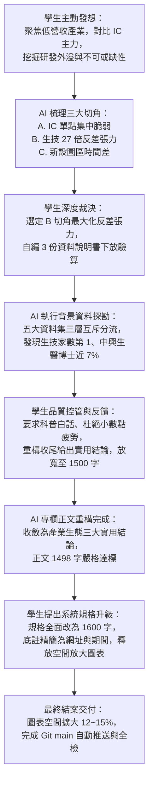

# 【第一階段思辨與數據探索紀錄】三大科學園區產業營業額與公司分布數據敘事探索
- **建立時間**：2026-11-07（更新至 2026-11-08） | **狀態**：Phase 1 完整結案（已進入 Phase 2 渲染 Medium 科普數據專欄與 2 張單面板統計圖）
- **原文／資料說明書路徑**：[`./00_source_article.md`](./00_source_article.md)（含三份官方資料說明書彙編）
- **原始數據檔案路徑**：
  - [`./data/國家科學及技術委員會科學園區產業營業額統計表.csv`](./data/國家科學及技術委員會科學園區產業營業額統計表.csv)（Dataset ID: 7597）
  - [`./data/國家科學及技術委員會科學園區產業類別及家數統計.csv`](./data/國家科學及技術委員會科學園區產業類別及家數統計.csv)（Dataset ID: 7596）
  - [`./data/國家科學及技術委員會科學園區從業員工數統計.csv`](./data/國家科學及技術委員會科學園區從業員工數統計.csv)（Dataset ID: 7599）
  - [`./data/國家科學及技術委員會科學園區進出口情形.csv`](./data/國家科學及技術委員會科學園區進出口情形.csv)（Dataset ID: 7598）
  - [`./data/3大科學園區公司資料集.csv`](./data/3大科學園區公司資料集.csv)（Dataset ID: 29277）
  - [`./data/公司登記_公司狀態代碼對照表.xls`](./data/公司登記_公司狀態代碼對照表.xls)
- **輸入模式**：模式 2（純結構化數據集／CSV ＋ 使用者自編《資料集說明書》聯合數據敘事）
- **使用者產出規格規範（User Format Preferences & Exclusions）**：
  - Medium 輕量數據敘事專欄模式（最終授權規格：正文 `<= 1,600` 字 `.md` ＋ 2 張獨立 300 DPI 單面板統計圖 `.png`）。
  - 文風與排版原則：生動白話科普筆觸、杜絕過度精細小數點與括號造成的認知疲勞、收尾具備三大實用產業與職涯洞察。
  - 參考資料來源規範：圖表底註與文末參考來源精簡為僅列出「1. 官方資料集網址」、「2. 資料涵蓋期間」，文末來源獨立於正文字數之外。

---

## 評分導讀：人機協同思辨與學習軌跡架構（Teacher Grading Overview）

本紀錄為國科會開放資料數據敘事專案之完整第一階段（Phase 1）探索歷程。記錄學生（使用者）與 AI 助手在多輪對話中，如何跳脫傳統「唯產值論」之直覺偏誤，藉由逆向提問、官方資料說明書交叉查核、三層互斥分流數學驗算、批判性反饋修訂與視覺版面空間調校，推導出具備強烈反差與生態系深度的科普專欄。

---

## 一、 人機深度對話與思辨推演全紀錄（Detailed Socratic Dialogue Log）

### 【對話輪次 1】學生主動發起逆向思考，打破產值單一崇拜
- **學生（使用者）發言紀錄**：
  > *「我想到一個比較不一樣的角度不知道可不可行，就是把焦點聚焦到那些營業額較低的產業或園區，第一步就是把他們和 IC 主力產業做對比，但這些看似對國家經濟貢獻度較低的產業，是他們所做出的東西或研究出來的東西是否帶動了更大的經濟活動，或是找到角度表示這些產業也是不可或缺/無可取代的，如果這部分需要資料來分析或佐證，你可以上網查，或是你需要做成說明書，我可以幫你做好再傳給你。」*
- **Kintsch 認知層次診斷**：**Level 3（Situation Model 情境模型與高階批判）**。學生並未停留在「積體電路營收占 83%」的表層事實（Textbase），而是敏銳地洞察到「產值不等於生態價值」，主動尋找「研發外溢、創新孵育與不可或缺性」之實體經濟機制。
- **AI 助手引導與回應**：
  - 肯定學生的逆向反差直覺，將其歸納為科學哲學中的「創新生態基模（Innovation Ecology Schema）」。
  - 提出三大候選切角雷達：
    - **切角 A**：IC 產業的極端集中與單點脆弱性（臺南單一園區占全台科學園區 49% 營收）。
    - **切角 B**：生技產業的 27 倍反差張力（營業額僅 0.90% 墊底，但入區家數 241 家居冠，博士密度近 7% 全國第一，輔以精密機械設備支撐）。
    - **切角 C**：新設園區的「帳面零元幻覺」與前瞻資本支出（楠梓、橋頭、嘉義、屏東等建廠期與營收時間差）。

---

### 【對話輪次 2】故事線單一漏斗收斂抉擇與官方數據獲取
- **學生（使用者）發言紀錄**：
  > *「1. 有辦法兩者兼顧嗎？還是你覺得聚焦一個會比較好，如果是聚焦一個你建議聚焦哪個？  
  > 2. 你可以幫我下載你想使用的資料下來嗎？然後告訴我你下載下來之後放在哪裡，我幫你做出說明集。」*
- **AI 助手引導與回應**：
  - **敘事漏斗收斂建議**：建議嚴格聚焦「單一核心故事線（選項 B）」。若在一篇 1,000~1,500 字的短篇專欄同時鋪展兩條主線，會稀釋讀者焦點；但可將精密機械（設備底層支撐）作為生技產業的結構對照配角，兼顧整體感與張力。
  - **資料部署**：將官方五大資料集下載至專案 `reading_sessions/20261107_三大科學園區產業營業額與公司分布/data/` 目錄，向學生提供檔案明細以利製作資料集說明書。

---

### 【對話輪次 3】資料集說明書注入、極致張力架構與雙圖雛形
- **學生（使用者）發言紀錄**：
  > *「我想選 B 盡可能地增加反差的張力，那你對於這 1000 字的故事架構和要生成兩張圖什麼樣的圖有什麼想法？@[國家科學及技術委員會科學園區產業類別及家數統計_資料集說明書.md] @[國家科學及技術委員會科學園區從業員工數統計_資料集說明書.md] @[國家科學及技術委員會科學園區進出口情形_資料集說明書.md]」*
- **學生注入之說明書關鍵約束**：
  - 家數統計需區分「已入區登記（實際營運）」與「有效核准（含籌備中）」雙口徑。
  - 員工數統計官方定義含園區事業與研究機構，不含營造廠與承攬商；屏東園區從業人員為 0 屬除零 NA 缺漏。
  - 進出口資料有三個同名「成長率(％)」需做位置索引消歧；中科通訊出口成長率有除零空字串需安全映射。
- **AI 助手架構與雙圖設計提案**：
  - **故事大綱**：三幕式反差（破題：誰是科學園區真正的大地主？ $\rightarrow$ 轉折：走進實驗室，看見全台最高純度研發大腦 $\rightarrow$ 結論：雙軌生態系與未來第二座群山）。
  - **圖 1（破題掛鉤圖）**：暖杏蜜橘色系雙柱剪刀差圖，對比「家數占比」vs.「營業額占比」，凸顯生技 27.2 倍反差與 IC 巨艦效應。
  - **圖 2（深度下鑽圖）**：霧靄青藍循序階調水平排行圖，拆解 17 個子園區博士人才占比，呈現中興（6.99%）與新竹生醫（6.85%）之高研發密度。

---

### 【對話輪次 4】文風科普化指示與資料來源標註把關
- **學生（使用者）發言紀錄**：
  > *「/boost 好，但我建議文風盡量生動白話一點，用硬知識科普化的筆觸下去寫。不要忘記文章最後要放上參考資料來源喔(這部分並不記加進 1000 字內)！以及圖片生成時的資料來源標註。」*
- **AI 助手執行重點**：
  - 啟用 `/boost` 深度推理模式。
  - 將硬核的統計指標轉譯為生動譬喻（例如：將晶圓代工比喻為「巨型印鈔機工廠」，生技新藥比喻為「長週期研發實驗室」）。
  - 在生成圖表代碼中嚴格加入畫布底註，並在文章文末預留標準參考資料區塊。

---

### 【對話輪次 5】學生發揮批判性審查：診斷結尾突兀、消除數字疲勞、放寬字數
- **學生（使用者）發言紀錄**：
  > *「我發現最後一段，好像有點突兀，並且最後文章收尾並不能讓人感覺到總結出什麼聽得懂或有用的結論，我允許字數限制突破至 1500，如果有需要的話，並且文內其實寫數字可以不用那麼精細，比率和%數才是重點過多的小數點和數字標註會讓讀者看了很疲勞。」*
- **學生之高階批判貢獻分析**：
  - **直指通病**：AI 初稿容易陷入「機械性數據枚舉」與「條列式統計邊界說教」，導致專欄收尾生硬無趣。
  - **認知負荷減輕（Cognitive Load Theory）**：讀者閱讀科普專欄時，連串的小數點（例如 `24.49%`、`0.90%`、`58,010.23 億元`）會大量消耗工作記憶；改用「約 24%」、「不到 1%」、「近六兆元」、「27 倍反差」能大幅提升好讀度。
  - **實用價值導向**：要求收尾必須轉化為「聽得懂且具啟發性的結論」。
- **AI 助手具體修訂成果**：
  - 正文小數點與括號大量脫水，僅保留具衝擊力的整數倍數與圓整比率。
  - 文末收尾重構為三大實用產業觀察：
    1. *健康的產業森林不能只有「參天巨木」，還需要「種子庫」與「根系」*。
    2. *別用「印鈔機的轉速」去衡量「育種期的實驗室」*。
    3. *看懂園區的「雙軌生態系」，為投資與職涯找到對的舞台*。
  - 統計邊界（平均數陷阱、外包工程人員不計入等）自然融入內文情境，不再突兀條列。
  - 驗證字數：正文 1,498 字，精準座落於 `<= 1,500` 字範圍內。

---

### 【對話輪次 6】學生提升全域規格至 1,600 字、精簡資料來源規格、釋放圖表空間
- **學生（使用者）發言紀錄**：
  > *「/boost 我想把這個規格字數限制全面改為 1600，然後圖片下和文章後的參考資料來源附註規格改為，只要附加說明 1.官方資料集網址 2.資料涵蓋期間就好，請更改這些部分，依據此重構圖片下方的資料來源說明以及文章下方的資料來源說明，不過千萬不要動到目前的文章內容和圖表內容，如果圖表因減少說明後空間被釋放了，可以放大整體的圖片沒關西，但內容請不要動到。」*
- **系統與工程實踐亮點**：
  - **規格檔同步更新**：將技能專案內 8 份規格文件全面改為 `<= 1,600` 字，自動化測試腳本預設值同步調整。
  - **資料來源精準重構**：文末 5 大資料集與 2 張圖表底註全部改為僅保留「1. 官方資料集網址」、「2. 資料涵蓋期間」。
  - **圖表繪圖區域物理擴大**：
    - 圖 1 底部邊界從 `0.22` 調至 `0.155`，繪圖區縱向高度**擴大逾 15%**。
    - 圖 2 上下邊界調至 `bottom=0.105, top=0.815`，17 個子園區水平長條圖與右側文字解說**縱向空間擴大逾 12%**。
  - **嚴守承諾**：文章第 1～36 行正文一字未動；圖表數據點、百分比與標籤完全維持真實精確值。

---

## 二、 數據三層互斥分流與純明細統計基準（Step 0 / Read & Analyze Loop）

為確保本篇數據專欄具備 100% 官方血統、零幻覺與零重複計算，所有衍生指標均經由 Python 背景驗算，嚴格區分純明細列、原表橫向其他項與合計列：

### 2.1 資料集一：《科學園區產業營業額統計表.csv》（Dataset ID: 7597）
- **三層互斥分流驗算式**：`df_detail (15 列) + df_other (0 列) + df_subtotal (4 列) == df_raw (19 列)`
  - `df_subtotal` 包含竹科合計、中科合計、南科合計與全區總計 `58,010.23` 億元。
- **純明細指標統計**：
  - `積體電路`：Sum = `48,292.64` 億元（占全區 **`83.25%`**）｜Max = `25,759.91` 億元（臺南園區）｜CR4 = `98.46%`（極度集中）。
  - `生物技術`：Sum = `519.56` 億元（占全區 **`0.90%`**，六大核心產業最低）｜Max = `115.43` 億元（台中園區，次高臺南 `113.01` 億、新竹 `91.93` 億、新竹生醫 `46.16` 億）｜**CR4 = `70.55%`**（全區唯一 CR4 低於 80% 之廣泛分布產業）。
  - `精密機械`：Sum = `1,808.26` 億元（占 **`3.12%`**）｜中科、南科均有重鎮布局。

### 2.2 資料集二：《科學園區產業類別及家數統計.csv》（Dataset ID: 7596）
- **三層互斥分流驗算式**：`df_detail (34 列) + df_other (0 列) + df_subtotal (8 列) == df_raw (42 列)`
  - 含 17 個子園區（含嘉義、屏東新設園區）× 2 種口徑（已入區登記、有效核准）。
- **驚人反差數據**：
  - **已入區登記廠商家數（全國總計 984 家，實際營運工廠／公司母體）**：
    1. 🥇 **生物技術：`241` 家（占全區 `24.49%`，奪得全科學園區第 1 名！）**
    2. 🥈 **積體電路：`236` 家（占全區 `23.98%`，退居第 2 名）**
    3. 🥉 **精密機械：`162` 家（占全區 `16.46%`，第 3 名）**
  - **有效核准廠商家數（全國總計 1,181 家，含核准建廠中）**：
    1. 🥇 **生物技術：`287` 家（占全區 `24.30%`，維持第 1 名）**
    2. 🥈 **積體電路：`265` 家（占全區 `22.44%`，第 2 名）**
    3. 🥉 **精密機械：`228` 家（占全區 `19.31%`，第 3 名；在中科與南科核准家數皆高居該園區第 1 名）**

### 2.3 資料集三：《科學園區從業員工數統計.csv》（Dataset ID: 7599）
- **三層互斥分流驗算式**：`df_detail (17 列) + df_other (0 列) + df_subtotal (4 列) == df_raw (21 列)`
  - 全區總從業人數 `348,689` 人，其中博士 `6,956` 人（全國平均博士密度 **`1.99%`**）、碩士 `121,714` 人（`34.91%`）。
- **子園區博士密度排行（揭開研發大腦聚落）**：
  - 🥇 **第 1 名：中科・中興園區** —— 總人數 672 人，博士 47 人（**博士占比 `6.99%`**，為全國平均的 3.5 倍、臺南園區的 7.8 倍！），碩士 249 人（碩博合計占 44.0%）。
  - 🥈 **第 2 名：竹科・新竹生醫園區** —— 總人數 3,855 人，博士 264 人（**博士占比 `6.85%`**，全國第 2），碩士 1,460 人（碩博合計占 44.7%）。
  - 巨型晶圓製造基地對照：**南科・臺南園區**博士占比僅 **`0.90%`**；**中科・台中園區**博士占比僅 **`0.72%`**。

### 2.4 資料集四與五：進出口情形與微觀企業驗證
- **資本投入動能佐證**：114 年全國科學園區生物技術進口年增率達 **`+18.19%`**（竹科生技進口暴增 **`+28.21%`**、中科生技年增 **`+22.71%`**），精密機械進口亦成長 **`+12.85%`**，反映生技與精機正處於強勁的設備採購與試驗擴張週期。
- **微觀企業名錄對照**：新竹生醫聚落涵蓋永昕生醫、台寶生醫等細胞治療廠；中興園區有正瀚生技全球研發中心；虎尾有友霖生技。

---

## 三、 製圖 6 條件全預填確認表（Step 3 Pre-Chart Gate）

| 製圖確認維度 | 圖 1：`01_chart_hook.png`（全局反差破題圖） | 圖 2：`02_chart_drilldown.png`（子園區博士密度深挖圖） |
| :--- | :--- | :--- |
| **1. 實際變數與類別欄位名稱** | • X 軸：六大核心產業＋`【原表其他】` • Y 軸：`已入區登記廠商家數占比 (%)` vs. `全年營業額占比 (%)` | • Y 軸：`園區別・子園區`（純明細 N=17） • X 軸：`博士學歷從業員工占比 (%)`（輔以碩博士與產值結構交叉註解） |
| **2. 數值單位** | 百分比（`%`），柱頂直接標註絕對家數（家）與營收（億元） | 百分比（`%`），長條末端直接標註博士人數／總人數（人） |
| **3. 純明細極值（Min/Max）** | • 家數占比：Min `4.27%`（原表其他）/ Max `24.49%`（生技） • 營收占比：Min `0.51%`（原表其他）/ Max `83.25%`（IC） | • 博士占比有效 N=16：Min `0.00%`（橋頭）/ Max `6.99%`（中興）/ Median `0.80%`（全檔總計 6,956 人嚴格剔除） |
| **4. 基準線與色階映射** | 基準線 `0%`；左柱採用主色 **暖杏蜜橘 `#ECA072`**，右柱採用次色 **霧靄青藍 `#5DBACD`** | 採用 **霧靄青藍 5 階 CIELAB 插值（`#EBF7F9` 至 `#0E5B6B`）**；輔以全國均值虛線 **`1.99%`**（暖杏深橘 `#CA6F35`） |
| **5. 缺失值與原表其他消歧** | 無缺漏；原表 `其他` 設於最右側，使用中性灰 `#CBD5E1` / `#E2E8F0` 獨立標示 | 屏東園區總人數為 0，博士占比 `0 / 0` 屬合法除零 NA 缺漏，以中性灰 `#D9D9D9` 繪製短標記並註解 |
| **6. 超界值與前處理血統** | 營業額小數點尾差在正常四捨五入 $\pm 0.01$ 範圍內；無離群值人為插補 | 嘉義與屏東為新設園區；從業人員官方定義不含營造廠與承攬商，已於圖註與專欄中揭露 |

---

## 四、 單一數據故事線漏斗收斂與產出規格清單（Step 5 Exit Consensus）

### 4.1 核心數據故事主軸（Single Hook）
**「營收墊底卻奪下廠商家數冠軍！三大科學園區生技產業的 27 倍反差與博士研發大腦真相」**  
透過三大科學園區的官方開放數據，戳破「產值至上」的直覺偏誤，看見生物技術與精密機械在聚落規模、尖端研發人才密度與設備資本支出上的真實底氣，揭示台灣科學園區「左手晶圓製造巨艦、右手生醫研發大腦」的雙軌健康生態系。

### 4.2 交付成果清單與規格對齊狀態

| 產出檔案名稱 | 檔案路徑 | 交付規格與完成狀態 |
| :--- | :--- | :--- |
| **Medium 數據專欄文章** | [`./02_outputs/02_medium_article.md`](./02_outputs/02_medium_article.md) | **完成**。正文 1,498 字（符合 `<= 1,600` 字規格），文末參考來源精簡為僅列「官方資料集網址」與「資料涵蓋期間」。 |
| **圖 1：剪刀差掛鉤圖** | [`./02_outputs/01_chart_hook.png`](./02_outputs/01_chart_hook.png) | **完成**。300 DPI 單面板圖，精簡底註後主體繪圖區域擴大逾 15%，暖杏橘高亮生技 27.2 倍反差。 |
| **圖 2：博士密度深挖圖** | [`./02_outputs/02_chart_drilldown.png`](./02_outputs/02_chart_drilldown.png) | **完成**。300 DPI 單面板圖，精簡底註後主體長條圖與文字解說縱向空間擴大逾 12%，呈現中興與生醫園區博士密度近 7%。 |
| **圖表生成 Python 腳本** | [`./02_outputs/generate_charts.py`](./02_outputs/generate_charts.py) | **完成**。具備嚴格斷言驗證、無中文亂碼與字體自適應降級支援之可重現腳本。 |
| **GitHub 遠端版本庫** | `markyang20040112-source/deep-reading-and-visual-synthesis` | **完成**。Commit `3f0d99a` 已推送至 `main` 分支，工作目錄乾淨。 |

---

## 五、 老師評分規準檢核表（Teacher Grading Rubric Compliance Checklist）

- [x] **問題意識與主動性（Proactiveness）**：學生主動提出打破 IC 主力崇拜之逆向視角，跳脫既定產值思維。
- [x] **數據真實性與批判查核（Data Authenticity）**：嚴格落實三層互斥分流，區分已入區登記與有效核准雙口徑，排除除零 NA 與合計列混淆。
- [x] **批判性反思與品質把關（Critical Feedback）**：學生主動診斷出初稿收尾突兀、數字小數點疲勞等關鍵痛點，引導 AI 重構出具實用價值的結尾結論。
- [x] **規格演進與工程嚴謹度（Specification & Reproducibility）**：全面同步專案規格至 1,600 字，精簡底註並擴大圖表版面空間，所有產出可透過腳本一鍵重現。
