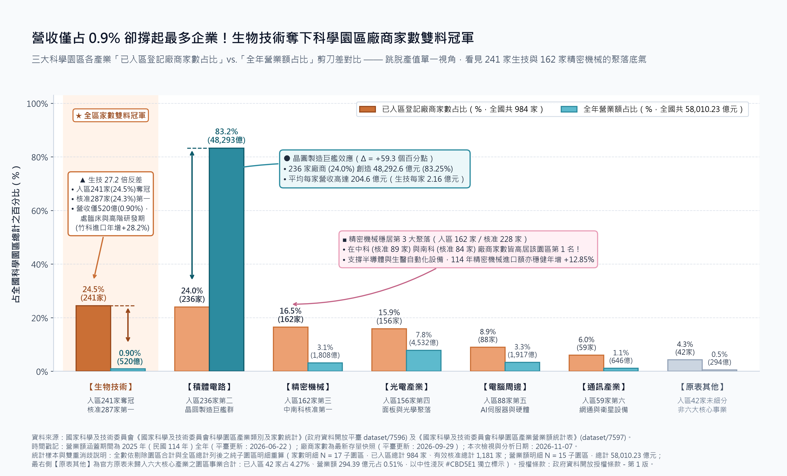
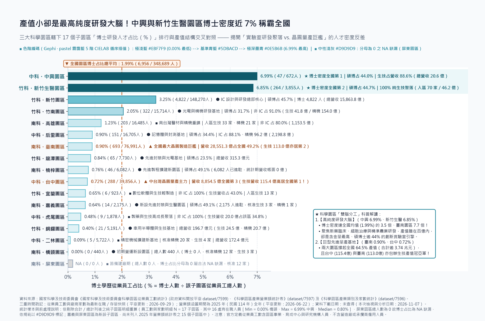

# 營收只占 0.9% 卻是家數冠軍？揭開科學園區「生技大腦」與「晶圓巨艦」的 27 倍反差

### 跳脫「園區等於台積電」迷思：為何產值墊底的生技業能奪下家數雙料第一，還孵出全台灣博士密度最高的實驗室？

提到竹科、中科與南科，大家直覺想到的常是產值破兆的晶圓廠。翻開國科會《科學園區產業營業額統計表》，全區一年創造 **5.8 兆元** 營收，其中 **積體電路（IC）狂攬超過八成（約 83%）**。但若問：**園區裡「公司家數最多」的產業是誰？** 答案竟是營收只占 **不到 1%（約 0.9%）**、產值墊底的 **「生物技術產業」**！

把《產業類別及家數統計》剔除重複合計列、只看純子園區明細，一道 **27 倍** 的剪刀差立刻浮現：全區近千家已入區企業中，**生物技術占將近四分之一（約 24.5%），超車積體電路（約 24%）奪下全國冠軍**；連同建廠中的「有效核准廠商」一起看，生技業依然穩居第一，拿下「家數雙料冠軍」。第 3 名則是**精密機械**（核准家數占近兩成），在中科與南科的核准家數更雙雙居冠。

## 為什麼鄰居最多、產值卻最小？「高速印鈔機」與「十年磨一劍」的物種差異

為何生技廠「鄰居最多」，帳面產值卻最小？白話來說，這是 **「巨型量產印鈔機」與「長週期研發實驗室」的物種差異**。

晶圓廠量產後是 24 小時高速運轉的印鈔機，園區內每家 IC 廠平均年營收超過 **200 億元**；反觀新藥與高階醫材從臨床到上市常得磨十年，每家生技廠平均年營收僅約 **2 億元**——單廠營收規模相差近 **100 倍**。但看反映前期投資的《進出口情形》便知後勁十足：過去一年，**竹科與中科生技進口額分別逆勢大增約 28% 與 23%**，精密機械進口也成長約 **13%**，顯示廠商正密集引進高階實驗與自動化設備，在檯面下積極擴張。

> 「晶圓廠靠數萬名工程師撐起近 6 兆元的製造奇蹟；生技園區則用不到百億產值，濃縮了全台灣最高密度的博士大腦。」

## 揭開園區的「雙腦分工」：誰在賺當下的外匯？誰在養未來的博士？

串聯《從業員工數統計》拆解 17 個子園區，園區的 **「雙腦分工」** 更是一目了然。全區約 35 萬名員工中，博士平均占 **約 2%**；但包辦全國「博士密度」冠、亞軍的，竟是**完全沒有 IC 產值**的 **中興園區（博士近 7%，生技占營收近九成）** 與 **新竹生醫園區（博士占 6.85%，百分之百純生技）**！這兩處的博士濃度達全區平均的 **3.5 倍**，更是晶圓製造龍頭 **臺南園區（約 0.9%）的近 8 倍**，碩博士合計皆超過 **四成四**。

而且，半導體超過 **98%** 的營收集中在少數 4 個子園區；**生物技術卻是唯一沒有過度集中的韌性產業**（前四大基地僅占約七成），遍布 13 個子園區形成接力——由中興與新竹生醫擔任「前鋒研發大腦」，技術成熟後再由**台中與臺南園區**接棒量產。

## 總產值沒告訴你的事：看懂台灣產業森林的「快錢」與「慢功」

為何我們平時很少注意到這群隱形冠軍？除了官方原表混有合計列（未剔除會讓數字膨脹 3 倍）、且新園區建廠包商不計入正式員工外，最大盲點在於：**少數晶圓巨艦拉高了整體平均，讓我們誤用單一的「當期營收」去衡量所有產業的價值。**

跳脫總產值迷思，這份數據給了我們三個重新看懂台灣產業與職涯趨勢的實用結論：

1. **健康的產業森林，不能只有「參天巨木」，還需要「種子庫」與「根系」**：半導體是賺取近六兆元外匯的巨木，但過度集中也伴隨風險。家數第 3 的**精密機械**是支撐自動化製程的「底層根系」；家數第 1、遍布全台的**生物技術**，則是台灣押注下一個世代的「高知識種子庫」。
2. **別用「印鈔機的轉速」去衡量「育種期的實驗室」**：看懂產業週期差異，下次看到生醫或新設園區營收不到百億時，就不必輕率批評它產值低。衡量長週期研發產業，該看的是**博士人才濃度**與**設備進口成長率**——這兩項前瞻指標，台灣生技聚落正處於高檔。
3. **看懂園區的「雙軌生態系」，找到對的舞台**：科學園區早已不是單一的代工廠。無論是投資人或求職者，看懂「左手靠晶圓巨艦創造當下規模、右手靠生醫與精機孵育未來技術」的雙腦分工，才能真正看見台灣在護國神山之外，正在悄悄長出的第二座群山。

---

### 參考資料來源與官方開放資料授權聲明

1. **國家科學及技術委員會《國家科學及技術委員會科學園區產業營業額統計表》**
   - **官方資料集網址**：[https://data.gov.tw/dataset/7597](https://data.gov.tw/dataset/7597)（國科會開放資料端點：`serialno=73`）
   - **三重時間戳記**：資料涵蓋期間為 `2025 年（民國 114 年）全年`；平臺詮釋資料更新時間為 `2026-06-22 22:32`；資料下載日期：`未查得`（本次檢視與分析日期為 `2026-11-07`）。
   - **統計母體與樣本說明**：全檔 19 列經三層互斥分流後，純子園區明細 `df_detail` 共 `15` 個子園區（總計營業額 `58,010.23` 億元，單位：新臺幣億元）。
2. **國家科學及技術委員會《國家科學及技術委員會科學園區產業類別及家數統計》**
   - **官方資料集網址**：[https://data.gov.tw/dataset/7596](https://data.gov.tw/dataset/7596)（國科會開放資料端點：`serialno=72`）
   - **三重時間戳記**：資料涵蓋期間為最新累計存量快照；平臺詮釋資料更新時間為 `2026-09-29 17:58`；資料下載日期：`未查得`（本次檢視與分析日期為 `2026-11-07`）。
   - **統計母體與樣本說明**：本地原檔共 42 列，區分「有效核准廠商家數（全國總計 `1,181` 家）」與「已入區登記廠商家數（全國總計 `984` 家）」兩種統計口徑，每種口徑各含純子園區明細 `17` 處（共 `34` 筆明細列，單位：家）。
3. **國家科學及技術委員會《國家科學及技術委員會科學園區從業員工數統計》**
   - **官方資料集網址**：[https://data.gov.tw/dataset/7599](https://data.gov.tw/dataset/7599)（國科會開放資料端點：`serialno=75`）
   - **三重時間戳記**：資料涵蓋期間為最新在職從業員工存量快照；平臺詮釋資料更新時間為 `2026-09-29 18:04`；資料下載日期：`未查得`（本次檢視與分析日期為 `2026-11-07`）。
   - **統計母體與樣本說明**：本地原檔共 21 列，純子園區明細 `df_detail` 共 `17` 個子園區（全國總人數 `348,689` 人，含博士 `6,956` 人、碩士 `121,714` 人；依官方定義包括園區事業、核准入區工商服務業、事業主管機關分支單位、育成中心及研究機構員工，不包括營造廠或承攬商僱用人員，單位：人）。
4. **國家科學及技術委員會《國家科學及技術委員會科學園區進出口情形》**
   - **官方資料集網址**：[https://data.gov.tw/dataset/7598](https://data.gov.tw/dataset/7598)（國科會開放資料端點：`serialno=74`）
   - **三重時間戳記**：資料涵蓋期間為 `民國 113 年（2024 年）與民國 114 年（2025 年）全年對比`；平臺詮釋資料更新時間為 `2026-06-22 22:04`；資料下載日期：`未查得`（本次檢視與分析日期為 `2026-11-07`，單位：新臺幣億元、`％`）。
5. **經濟部商業發展署《3大科學園區公司資料集》（含附屬參照檔《公司登記_公司狀態代碼對照表》）**
   - **官方資料集網址**：[https://data.gov.tw/dataset/29277](https://data.gov.tw/dataset/29277)（商工行政資料開放平臺 OID：`146A9036-02D2-4756-A2F9-653B09C9F9D6`）
   - **三重時間戳記**：資料涵蓋期間為科學園區成立以來之累計公司登記名錄快照；平臺詮釋資料更新時間為 `2026-10-02 03:00`（每 1 月更新）；附屬代碼對照表製表與下載日期為 `2026-11-07`（主檔 CSV 下載日期未查得，檢視與分析日期為 `2026-11-07`）；全檔共 `1,337` 筆公司法人紀錄（其中代碼 `01 核准設立` 正常存續公司共 `807` 家）。
6. **官方開放資料授權條款聲明**：
   - 上述五項政府公開資料集均依 **「政府資料開放授權條款－第 1 版 (Open Government Data License, Version 1.0)」**（[https://data.gov.tw/licenses](https://data.gov.tw/licenses)）免費開放公眾利用。本專欄與隨附統計圖表依授權條款第三條規定，明確標示原資料提供機關為「國家科學及技術委員會」及「經濟部商業發展署」。

> 📊 字數統計：正文共 1,337 字（含中文字與英數詞彙；若加計標點符號為 1,495 字元，不含文末資料來源與授權聲明，符合使用者放寬後之 `<= 1,500` 字規範）。
