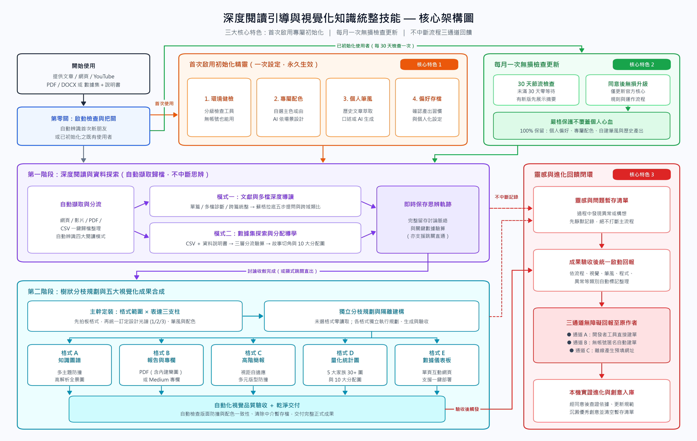
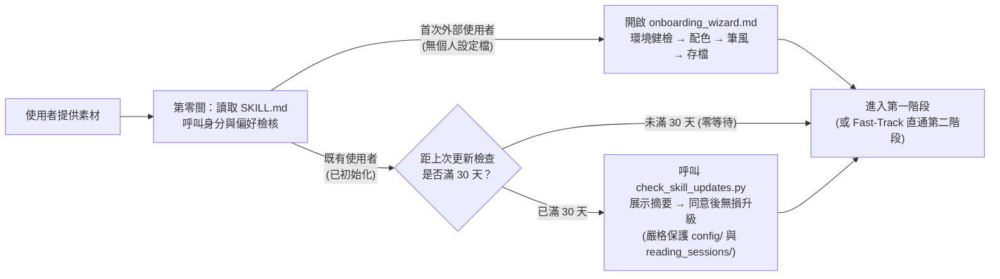
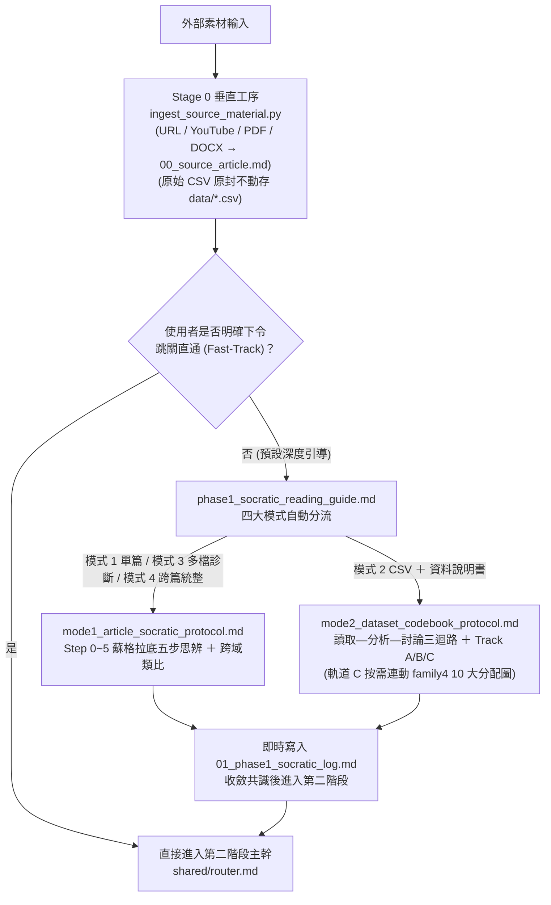
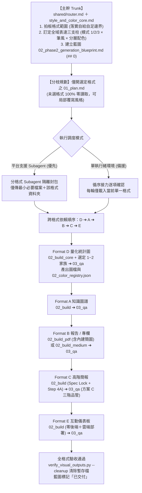
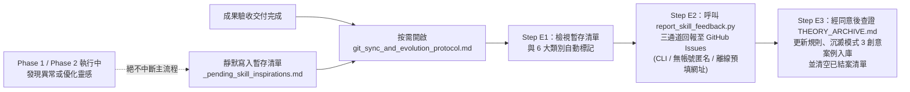

# 深度閱讀引導與視覺化知識統整技能 — 完整介紹與架構指南

> 本指南採**「由淺入深」**結構編寫：
> - **壹、白話技能功能與架構解說**：用零技術門檻的白話，帶您快速理解這個技能能解決什麼問題、有哪些亮點，以及實際用起來像什麼體驗。
> - **貳、技能架構流程與模組職責詳解**：拆解底層的「樹狀主幹分枝」「Subagent 隔離」「黑盒引擎」設計巧思，並提供完整的 Mermaid 流程圖與每一份 `.md`、`.py`、`.js` 檔案的精準定位。

---

# 壹、白話技能功能與架構解說

## 一、 這個技能在解決什麼痛點？

平常我們把一篇長文、論文或一份 CSV 數據丟給一般 AI，最常遇到三個困擾：

1. **一秒丟出罐頭摘要，大腦完全沒吸收**：AI 幫你條列五點重點，看完好像懂了，過兩天卻完全忘記，也沒有真正思考文章的邏輯漏洞或應用場景。
2. **分析數據常亂猜、算錯，圖表還會爆版**：直接叫 AI 讀大型 CSV 不但浪費大量上下文，還容易把「合計列」當成「單一項目」一起算極值；畫出來的中文圖表常常文字重疊、配色刺眼或比例失真。
3. **產出風格漂浮不定、每次都要重講偏好**：今天寫報告太像公文、明天做簡報字太小，每次開新對話都要重新交代自己喜歡的語氣、色票與版面習慣。

**「深度閱讀引導與視覺化知識統整技能」**就是為了徹底解決這三個痛點而打造的——它先當你的**蘇格拉底思辨教練／數據偵探**，陪你把內容真正讀透；再化身**出版級設計與製圖工作室**，把你的思考結晶精準轉化為圖譜、報告、簡報、統計圖或互動儀表板。

---

## 二、 五大核心特色與設計亮點

1. **首次啟用專屬初始化，一次設定永久生效**
   - 第一次使用時，技能會啟動引導精靈，幫你完成「環境健檢（沒裝進階工具或無帳號也能用）➔ 專屬配色設計 ➔ 個人筆風建立（可從你的歷史文章萃取、口述或由 AI 協助生成）➔ 產出習慣存檔」。
   - 之後每次使用都會自動套用你的個人化設定，再也不用重複交代。
2. **每月一次無損檢查更新，100% 保護個人心血**
   - 每 30 天才靜默檢查一次官方核心是否有新版（未滿 30 天零等待）；有新版時先展示更新摘要，**經你同意才升級**，且只更新官方規範與引擎，**絕對不覆蓋**你的個人偏好、專屬配色、自建筆風與歷史閱讀紀錄。
3. **兩大閱讀探索引擎：文獻思辨 × 數據偵探**
   - **丟文章／網頁／YouTube／PDF／DOCX**：自動在背景擷取整理，不丟罐頭摘要，而是透過五步蘇格拉底提問與跨域類比，帶你把文章讀深、讀出批判觀點。
   - **丟 CSV 數據集＋《資料說明書》**：由背景程式零誤差做「明細 / 其他 / 合計」三層分流驗算，幫你找真實數據故事切角，甚至能一步步教你畫出與看懂 **10 大統計分配圖**。
   - 趕時間時也支援**「跳關直通（Fast-Track）」**，直接跳過討論進入成果製作。
4. **表達三支柱 × 五大出版級視覺化產出**
   - 產出前可自由搭配三大表現維度：**設計光譜**（標準嚴謹 / 編輯室敘事 / 開放創意隱喻）× **個人筆風（8 大場景插槽全格式穿透）** × **科學分層配色**。
   - 涵蓋五大成果格式（知識圖譜、PDF 報告／Medium 專欄、16:9 視距自適應簡報、5 大家族 30+ 統計圖、單頁互動儀表板），而且**每一份成果做完都會自動轉圖、檢查防撞與配色，清理暫存檔後才交給你**。
5. **不中斷流程的靈感與進化回饋閉環**
   - 閱讀或製圖途中若發現任何怪地方或靈感，技能會先靜默記到暫存清單，**絕不打斷你當下的思緒**；等成果驗收完成後再統一整理，提供「開發者工具 / 無帳號匿名 / 離線預填網址」三通道回報給原作者，並可在本機經你同意後查證依據、進化規則與沉澱優秀創意。

---

## 三、 超白話運行流程（像走五關一樣簡單）

想像你今天拿到一份棘手的產業報告或公開數據集，整個使用流程就像這樣：

1. **第 1 關｜把素材丟進來**：貼上網址、YouTube 連結、PDF/Word、純文字，或是丟進 CSV＋資料說明書。技能會先確認你的個人化設定就緒，並在背景自動把素材整理歸檔。
2. **第 2 關｜一起把內容讀透（第一階段）**：
   - 如果是文章：AI 會先問你初步想法，接著一步步追問核心論點、反例邊界與跨領域類比，幫你把散落的資訊整理成扎實的個人觀點。
   - 如果是數據：AI 會在背景把數據清洗分流、算好真實極值與偏態，列出幾個最有意思的故事切角讓你挑，一起把想說的故事收斂清楚。
   - *(每輪討論都會即時存檔，就算換電腦或隔天再聊也能無縫接續；如果當下只想快速出圖，直接說「跳過討論直接生成」即可。)*
3. **第 3 關｜點菜選格式與定裝（第二階段主幹）**：決定這次要產出哪些成果（可單選或多選 A～E），並拍板整體的設計風格、筆風與主色系。
4. **第 4 關｜逐項細部規劃、製作與自動體檢（獨立分枝）**：每種選定的格式會各自確認細節後獨立製作。技能內建的程式引擎會精準排版、畫圖、鎖定跨圖顏色，做完立刻自動檢查有沒有文字重疊、破版或跑色，確認過關並清掉暫存檔才交付給你。
5. **第 5 關｜乾淨結案與進化回饋**：所有成果確認滿意後，如果剛才有記下任何優化靈感或問題，技能會在這時統一問你要不要回報或升級規則，讓工具越用越順手。

---

## 四、 速查表：我該選哪一種產出格式（A～E）？

| 格式 | 成品形式 | 最適合的情境 | 核心亮點 |
| :--- | :--- | :--- | :--- |
| **格式 A：知識圖譜** | 高解析全景 `.png` 圖表 | 想一眼看懂複雜文章脈絡、系統架構或批判對比 | 5 大瑞士網格拓撲、自動防撞排版、分支過多自動無損拆圖 |
| **格式 B：報告與專欄** | 印刷級 A4 `.pdf` **或** 純淨 Medium `.md` 專欄 | 正式研究報告、讀書筆記歸檔，或每週一圖數據專欄 | PDF 內建專屬直向流程簡圖；Medium 自動嚴控字數與原生格式 |
| **格式 C：高階簡報** | 16:9 `.pptx` 簡報檔 | 會議口頭報告、課堂發表、提案簡報 | 視距自適應大字級、5 大家族 13 種無框版型、三階視覺品管 |
| **格式 D：量化統計圖** | 高解析統計圖 `.png`（可選附簡報寬版） | 數據分析、論文插圖、數據新聞、學習統計分配 | 涵蓋 5 大家族 30+ 圖型與 10 大分配圖，跨圖類別自動鎖色 |
| **格式 E：數據儀表板** | 零後端單頁互動網頁（可離線雙擊或一鍵上線） | 想讓讀者自己篩選、滑鼠懸停看明細的互動作品 | 純靜態免架伺服器、內建互動圖表、支援一鍵部署到雲端網站 |

---

# 貳、技能架構流程與模組職責詳解

這一部分寫給想理解本技能**「為什麼能維持高穩定度、低幻覺、低 Token 消耗」**的進階使用者與維護者。

## 一、 四大底層架構巧思

1. **樹狀主幹分枝 ＋ $O(1)$ 按需載入（Thin Trunk + Independent Branches）**
   - 傳統大型 Prompt 往往把所有規則塞成一份數萬字長文，導致 AI 注意力稀釋、顧此失彼。
   - 本技能將總控台 `SKILL.md` 與 Phase 2 主幹壓在 `<= 8KB` 紅線內，並把五大格式徹底拆成五個獨立資料夾（各自內聚 `01_plan ➔ 02_build* ➔ 03_qa`）。**未選中的格式 100% 零讀取**，確保 AI 在任何時刻只專注於當下最精準的規則。
2. **分格式 Subagent 隔離（＋單執行緒循序備援）**
   - 在支援 Subagent 的平台，主對話負責與人對齊決策與維護藍圖，真正耗費上下文的「單格式建構與驗收」則打包最小必要資料交由獨立 Subagent 執行，避免前一個格式的程式碼污染下一個格式的注意力。
   - 若環境不支援 Subagent，則無縫降級為單執行緒依 `D ➔ A ➔ B ➔ C ➔ E` 循序接力、逐項確認。
3. **底層引擎黑盒鐵律（Black-Box Scripts）**
   - 所有容易出錯的工程細節（網頁/YouTube/PDF 擷取、CIELAB 色彩科學、CSV 三層分流、文字實寬量測與防撞、PDF/PPTX 編譯與轉圖驗收）全部封裝在 `scripts/*.py` 與 `scripts/*.js`。
   - AI 日常只看規範檔中的 API 簽名直接呼叫，**嚴禁讀取底層腳本原始碼**（除錯除外），大幅節省 Token 並確保渲染結果具備高度確定性。
4. **公私雙倉庫隔離 ＋ 7 套自動化安全網測試**
   - 公開倉庫只存放規範、引擎與公開範本；個人設定、自訂筆風與所有 `reading_sessions/` 專案紀錄透過 `.gitignore` 徹底隔離，兼顧隱私與無損更新。
   - `tests/` 內建 7 套回歸測試（涵蓋色彩登記表、圖表防撞、PDF 管線、知識圖譜與擷取、PPTX 13 版型、儀表板封裝、Markdown 樹狀斷鏈與體積紅線），確保每次修改都不會破壞既有能力。

---

## 二、 四大階段端到端流程圖解

### 1. 第零關（Gate 0）：啟動把關、初始化與無損更新

### 2. 第一階段（Phase 1）：Stage 0 自動擷取與四大輸入模式分流

### 3. 第二階段（Phase 2）：樹狀主幹分枝、跨格式依賴與隔離建構

### 4. 結案進化與回饋閉環（Step E1～E3）

---

## 三、 全系統 `.md` 規範檔定位與職責地圖

所有核心規範皆位於 `.agents/skills/deep-reading-and-visual-synthesis/` 下，嚴格遵循單一職責與按需載入原則：

### 1. 總控、設定、初始化與理論庫

| 檔案路徑 | 唯一職責與功能 | 開啟時機 |
| :--- | :--- | :--- |
| `SKILL.md` | **樹狀總控台（<=8KB）**：定義 Gate 0 身分與更新門神、五大核心運作鐵律、樹狀檔案地圖與 `reading_sessions/` 歸檔規則。 | 技能啟動時預設載入 |
| `THEORY_ARCHIVE.md` | **實證科學理論封存庫（T01～T26）**：收錄認知心理學、視覺感知、投影光學與排版工學文獻出處，作為規則演化的科學依據。 | 查核理論出處或結案 Step E3 |
| `config/user_preferences.template.json` | **個人化設定公開範本**：定義確認關卡、分層色票、筆風插槽映射、更新節流與 Git 同步欄位結構。 | 首次初始化或欄位參考 |
| `config/styles/_style_schema_template.md` | **8 插槽筆風控制契約（Slots 1～8）**：規範結構推演、開頭錨點、標題/講稿/微文案語氣與禁用詞護欄，讓筆風 100% 穿透五大格式。 | 建立新筆風檔時 |
| `setup/onboarding_wizard.md` | **外部新用戶初始化精靈**：引導完成環境分級健檢、專屬配色設計、筆風萃取與偏好存檔。 | 外部新用戶首次啟用（一次性） |
| `setup/git_sync_and_evolution_protocol.md` | **同步、開站與進化協定**：規範雙倉庫同步、Format E 防嵌套部署、Medium 繳交規範與 Step E1～E3 靈感回饋閉環。 | 全格式交付後按需開啟 |

### 2. 第一階段：深度閱讀與數據探索（`phase1_reading/`）

| 檔案路徑 | 唯一職責與功能 | 開啟時機 |
| :--- | :--- | :--- |
| `phase1_reading/phase1_socratic_reading_guide.md` | **Phase 1 總路由**：執行 Stage 0 素材擷取正規化、四大輸入模式自動分流、Fast-Track 判斷與 `01_phase1_socratic_log.md` 即時落盤。 | 進入 Phase 1 必讀 |
| `phase1_reading/mode1_article_socratic_protocol.md` | **文獻／多檔／跨篇思辨協定**：執行 Step 0～5 蘇格拉底鷹架、圖爾敏論證詰問、跨域類比與零刪減雙群組收斂。 | 屬模式 1 / 3 / 4 時單開 |
| `phase1_reading/mode2_dataset_codebook_protocol.md` | **CSV＋資料說明書三迴路協定**：零 Token 背景三層互斥分流、證據標籤與血統預警、Track A/B/C 故事探索與製圖 6 條件預填表。 | 屬模式 2 時單開 |

### 3. 第二階段主幹與共用核心（`shared/`）

| 檔案路徑 | 唯一職責與功能 | 開啟時機 |
| :--- | :--- | :--- |
| `shared/router.md` | **Phase 2 主幹總路由（<=8KB）**：格式分枝推薦、自給自足邊界鐵律（不濫選 A/D）、Subagent 隔離封包與單執行緒備援調度。 | 進入 Phase 2 必讀 |
| `shared/blueprint_template.md` | **樹狀藍圖範本（<=6KB）**：定義 `02_phase2_generation_blueprint.md` 的主幹 `## 0` 錨點與各格式分枝切片格式。 | 建立生成藍圖時 |
| `shared/style_and_color_core.md` | **混合式表達三支柱定裝核心（<=8KB）**：拍板全域預設「設計光譜（模式 1/2/3）× 筆風 × 分層色票」，並定義各分枝局部覆寫機制。 | Phase 2 主幹定裝時 |
| `shared/visual_cognition_core.md` | **跨格式視覺認知底盤**：無損擴展哲學、事實與因果保真底線、CJK 避頭尾保護與 75-20-5 色彩分配原則。 | 進入分枝建構時必讀 |
| `shared/editorial_narrative_spec.md` | **模式 2 編輯室敘事專檔**：資料八編輯室 5 大技法、聚光燈焦點、時期色帶、角落排行卡與跨格式敘事延伸（徹底解耦）。 | 僅開啟設計光譜「模式 2」時 |
| `shared/creative_armory/INDEX.md` ＋ `cases/*/*.md` | **模式 3 開放創意隱喻武器庫**：`INDEX.md` 作為單行索引入口與 Form-as-Metaphor 五大底線，依視覺編碼按需單開 `cases/` 下之原子案例卡（液體容器柱、遮罩紋理、空間隱喻等）。 | 僅開啟設計光譜「模式 3」時 |

### 4. 第二階段五大獨立格式分枝（`formats/`）

每個格式資料夾皆獨立內聚 **`01_plan.md`（分枝規劃）➔ `02_build*.md`（建構與 API 契約）➔ `03_qa.md`（視覺與結構驗收）**，未選中者 **0 讀取**：

| 格式資料夾 | 包含檔案 | 唯一職責與特色 |
| :--- | :--- | :--- |
| `formats/format_a_diagram/` | `01_plan.md`、`02_build.md`、`03_qa.md` | **知識圖譜**：無損多圖拆分（`01/02/03+`）、T1～T5 瑞士網格拓撲、`23.8"` 寬畫布防撞渲染與零穿線驗收。 |
| `formats/format_b_document/` | `01_plan.md`、`02_build_pdf.md`、`02_build_medium.md`、`03_qa.md` | **報告與專欄**：文體 1～4 A4 自適應印刷 PDF（含內建 `7.44"` 直向簡圖）vs. 文體 5 `<=1,600` 字純淨 Medium 專欄互斥雙軌。 |
| `formats/format_c_slides/` | `01_plan.md`、`02_build.md`、`03_qa.md` | **16:9 視距自適應簡報**：DISCAS 視距地板、北極星 AST、`02c_slide_spec_lock.json` 規格鎖定、五大家族 13 版型與方案 C 三階品管。 |
| `formats/format_d_charts/` | `01_plan.md`、`02_build_core.md`、`03_qa.md` ＋ `families/family1~5*.md` | **量化統計圖（5 家族 30+ 圖）**：4D 快篩 × 8 溝通意圖選型、編碼誠實三鐵律與 `02_color_registry.json` 跨圖鎖色；按需僅開 1～2 個 `families/` 微檔（含 `family4` 10 大分配圖逐步導學）。 |
| `formats/format_e_dashboard/` | `01_plan.md`、`02_build.md`、`03_qa.md` | **零後端互動數據儀表板**：呈現模式 A/B/C 動態選型、自包含單頁 HTML/CSS/JS、前端 `gephi_palette.js` 色彩連動、全景圖與雲端直推部署。 |

---

## 四、 全系統 `.py` / `.js` 黑盒引擎與 `tests/` 測試套件定位地圖

### 1. 素材擷取、色彩科學與雙倉同步（`scripts/`）

| 檔案路徑 | 核心定位與功能 |
| :--- | :--- |
| `scripts/ingest_source_material.py` | **Stage 0 四合一素材擷取引擎**：自動偵測並將網頁 URL、YouTube 字幕、本機 PDF、DOCX 清洗轉存為 `00_source_article.md`。 |
| `scripts/hcl_color_engine.py` | **統一相容門面（Facade）**：整合轉接色彩核心、類別鎖色登記表、雙倉同步與各繪圖模組之統一呼叫入口。 |
| `scripts/color_core.py` | **CIELAB / HCL 色彩科學核心**：管理全域色票契約、等色度科學色階、主題衍生與前端 JS 色票匯出。 |
| `scripts/color_registry.py` | **跨圖類別色彩登記表**：持久化維護 `02_color_registry.json`，確保同一實體在 Format D 多張圖與 Format E 儀表板中顏色 100% 一致。 |
| `scripts/owner_sync.py` | **身分識別與雙倉同步引擎**：區分外部使用者與原作者環境，處理個人設定載入、隔離保護與雙倉庫同步 CLI。 |
| `scripts/gephi_palette.js` | **前端色彩 SSOT（UMD/Browser/Node）**：提供 Format E 儀表板與 HTML 元件使用之 CIELAB 插值、類別色查詢與主題衍生函式。 |

### 2. 數據處理與 5 大家族繪圖引擎（`scripts/`）

| 檔案路徑 | 核心定位與功能 |
| :--- | :--- |
| `scripts/chart_data.py` | **輕量數據處理與三層分流引擎**：無痛處理 NA 與安全轉型，執行 `df_detail` / `df_other` / `df_subtotal` 標準三層互斥分流。 |
| `scripts/chart_common.py` | **繪圖共用底盤**：CJK 字型設定、黃金畫布工廠 `setup_chart_canvas`、去框線、聚光燈配色與 1D 標籤防撞工具。 |
| `scripts/chart_editorial.py` | **模式 2 編輯室敘事組件**：封裝膠囊基準線、時期色帶、角落排行卡與四層底註等新聞圖表視覺元件。 |
| `scripts/chart_family1_ranking.py` | **家族 1 排行與偏差引擎**：克里夫蘭點陣圖、啞鈴與雙向動量箭頭圖、斜坡圖、子彈圖等。 |
| `scripts/chart_family2_trend.py` | **家族 2 趨勢與對比引擎**：共用基線剪刀差折線＋面積帶、配對雙柱＋差距標註等。 |
| `scripts/chart_family3_composition.py` | **家族 3 佔比與流向引擎**：Marimekko 雙維佔比圖、增減瀑布圖等。 |
| `scripts/chart_family4_distribution.py` | **家族 4 分配與密度引擎**：非負裁切 KDE、背景基準分面（Context Overlay）與 10 大統計分配輔助繪圖。 |
| `scripts/chart_family5_multivariate.py` | **家族 5 多維與空間引擎**：全樣本波士頓四象限氣泡矩陣（含類別深色實心箭頭指引線）等。 |
| `scripts/chart_creative_armory.py` | **模式 3 創意隱喻圖引擎**：液體容器柱、遮罩紋理扇形、圖示座標散佈等創意資料視覺化原語。 |

### 3. 三大排版渲染、驗收與維運工具（`scripts/`）

| 檔案路徑 | 核心定位與功能 |
| :--- | :--- |
| `scripts/generate_mindmap.py` | **Format A 圖譜 ＋ Format B 簡圖引擎**：提供 `23.8"` T1～T5 瑞士網格圖譜原語，以及 Format B 專用 `7.44"` A4 直向輕量簡圖 API。 |
| `scripts/pdf_report_engine.py` | **Format B PDF 編譯引擎**：生成 A4 自適應分頁印刷 CSS，並透過 Playwright 單瀏覽器實例編譯高品質 PDF。 |
| `scripts/pptx_slide_engine.py` ＋ `scripts/pptx_engine/` | **Format C 16:9 簡報引擎套件**：門面檔整合 `tokens.py`（DISCAS 字級與設計代幣）、`text_layout.py`（Pillow 實寬量測與避頭尾）、`media_omml.py`（300 DPI SVG 與原生數學公式）、`primitives.py`（光學平衡與頁首尾）、`layouts_data.py` 與 `layouts_narrative.py`（五大家族 13 版型）、`spec_pipeline.py`（規格鎖定與確定性渲染）及 `qa.py`（方案 C 三階接觸表品管）。 |
| `scripts/verify_visual_outputs.py` | **視覺驗收與清理總管**：提供 Matplotlib 文字碰撞預檢、PDF/PPTX 轉圖、Medium 分離計字、`--verify-colors` 鎖色檢查、`--verify-dashboard` 封裝體檢，以及 `--cleanup` 清理中介暫存檔。 |
| `scripts/report_skill_feedback.py` | **三通道 GitHub Issues 回報工具**：支援 `gh` CLI 建單、無帳號匿名代理建單與離線預填網址產生。 |
| `scripts/check_skill_updates.py` | **30 天節流無損更新工具**：定期比對官方版本、產出變更摘要，並於同意後保護個人資料夾完成升級。 |

### 4. 七套自動化安全網回歸測試（`tests/`）

| 檔案路徑 | 驗證範圍 |
| :--- | :--- |
| `tests/run_all.py` | 一鍵執行全部 7 套安全網測試的總入口。 |
| `tests/test_color_registry.py` | 跨圖類別色彩登記表與色彩核心回歸測試。 |
| `tests/test_charts_regression.py` | 全圖表渲染、零文字碰撞與跨家族鎖色回歸測試。 |
| `tests/test_pdf_pipeline.py` | Format B PDF 自適應分頁與單瀏覽器重用測試。 |
| `tests/test_mindmap_and_ingest.py` | Format A 延遲載入出圖與 Stage 0 素材擷取離線測試。 |
| `tests/test_pptx_pipeline.py` | Format C 五大家族 13 版型端到端渲染與方案 C QA 測試。 |
| `tests/test_dashboard_bundle.py` | Format E Deploy-Ready 封裝體檢與防嵌套 `.git` 測試。 |
| `tests/test_md_architecture.py` | 樹狀 `.md` 架構完整性、零斷鏈、零舊路徑與主幹體積紅線測試。 |
